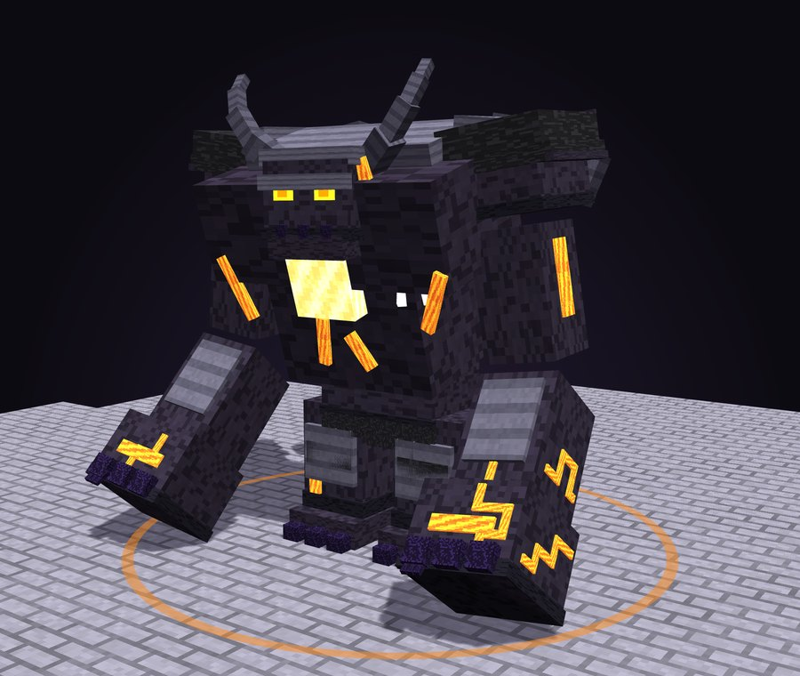
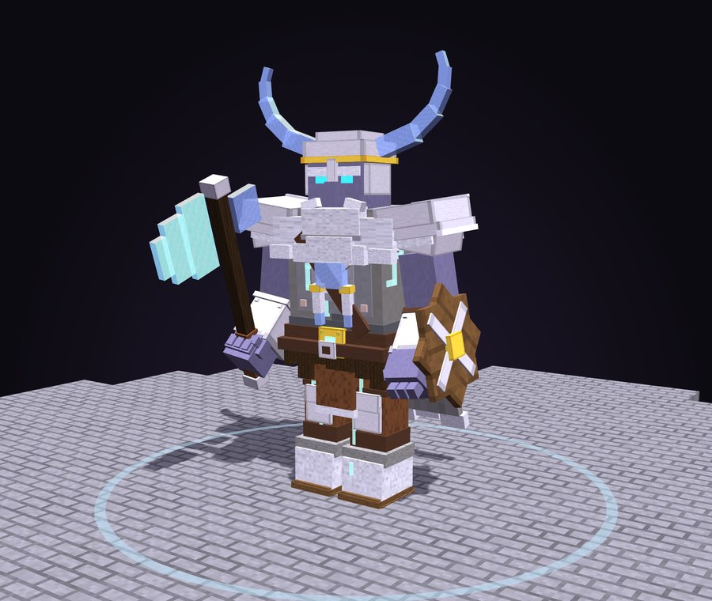
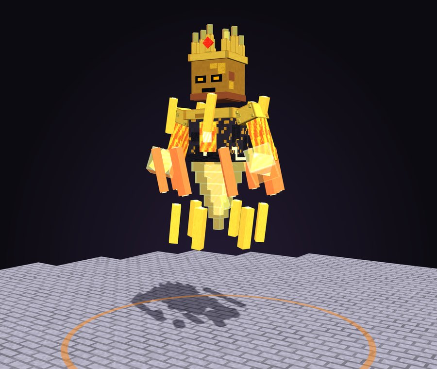
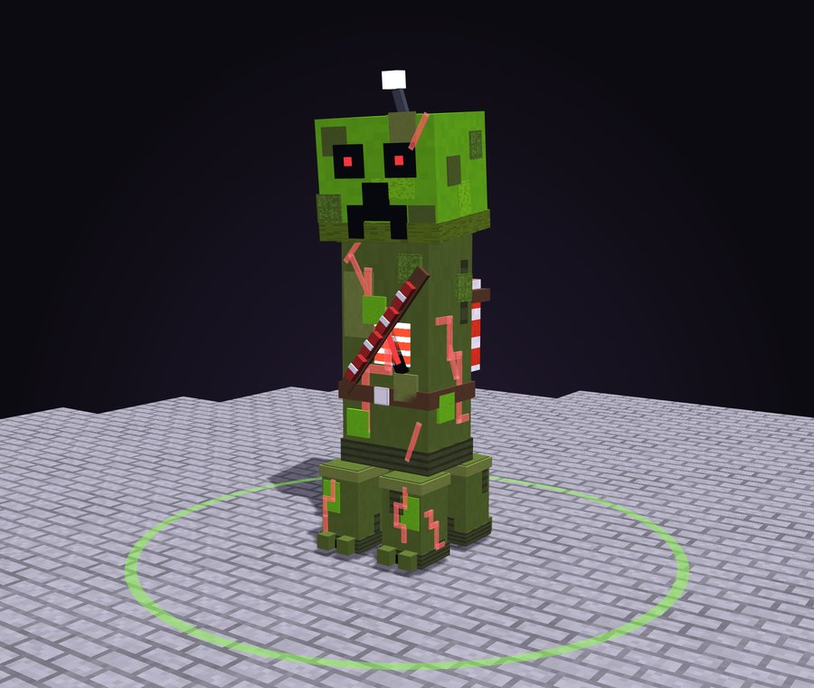
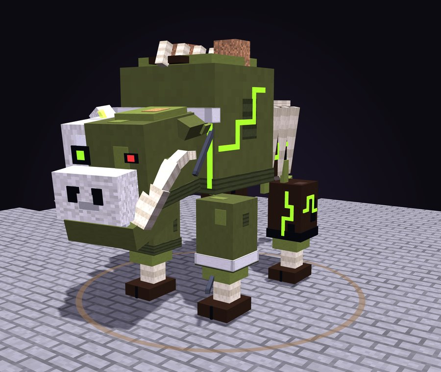
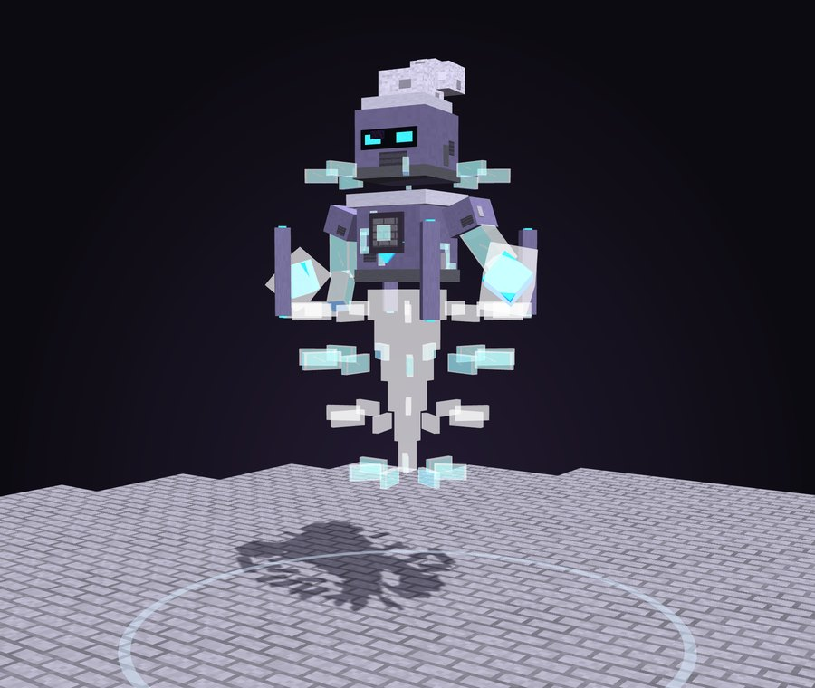
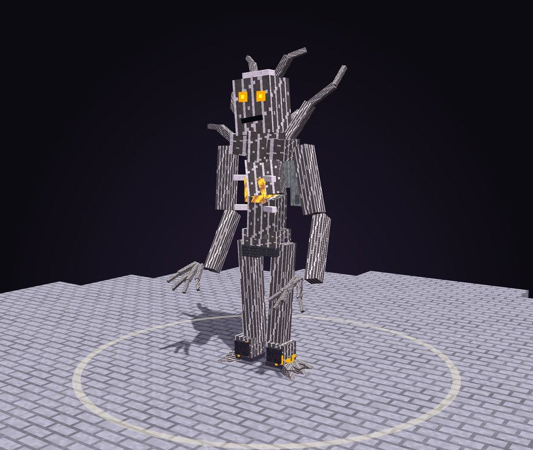

# CBosses

<p align="center"></p>

**CBosses** adds 43 animated block-model bosses to Paper and Folia servers. Every boss is built from 130 to
260 display blocks, has its own entrance, its own attacks and its own death, and runs on a schedule, on a
season, right after a player finishes a CQuests chapter, or as the finale once the three legends have fallen. It
works on its own and alongside **CQuests**, and it has full **WorldGuard** support.

### [Open the 3D boss viewer](https://claude.ai/artifact/NbYXjJCKyRwZ2oTmETby7k)

Spin every boss around, play its entrance, each attack and its death, right in your browser. A copy of the viewer is
also in this repo at [`docs/viewer.html`](docs/viewer.html) (download and open it locally).

## Highlights

- **Hand-finished models.** Every boss has at least 120 blocks: layered shoulder plates, knee guards, chest badges,
  spines, torn hems, rivets, shading patches and glowing veins on top of its own design. Turn the fine detail down
  with `effects.model-detail` on a busy server.
- **A different entrance for every boss.** Omens, ground cracks and a themed build-up first, then the boss climbs out of the
  earth, falls from the sky, assembles block by block, or, for Clucksworth, hatches out of a giant egg.
- **A different death for every boss.** Each death has a flash, a camera shake and a custom sequence: the veins go dark,
  the armour plates are thrown off, and most end with the model shattering into physics shards.
- **The finale.** Beat the Withered Tyrant, the Ender Wyrm and The Listener Below and **The Unmaker** wakes: a ten block
  tall, four-armed titan with a void heart, one great eye and a crown of orbiting shards.
- **Private chapter bosses.** A chapter boss appears where the player finished their quest and only exists for them:
  nobody else sees it, hears it, bumps into it or gets attacked. No boss ever breaks or places blocks.
- **Every word is yours.** All chat lines, titles, action bars, menus and the defeat broadcast are in `messages.yml`;
  boss names, titles and descriptions are in `bosses.yml`.
- **Attacks you can read.** Every ability has its own wind-up pose, effects and impact: slams, charges, dives, beams, meteors,
  spikes, sonic booms, minion waves and more. Flying bosses swoop and dive instead of jumping.
- **Chapter bosses.** A boss after every CQuests chapter (1 to 10), with two big set pieces after chapters 5 and 10.
- **Legend bosses.** The Withered Tyrant (a three-headed wither), the Ender Wyrm (a flying dragon) and The Listener Below
  (a warden-like horror) are the biggest fights in the plugin.
- **Seasonal bosses.** Halloween, Winterfest, Spring and Summer bosses, including Killer Claus, Brain Freeze and Clucksworth.
- **Built to stay light.** Models only update near players, movement uses client-side interpolation, particles and flying
  blocks have hard caps, and every cost can be tuned in `effects:`. Region schedulers make it Folia-safe.
- **Tested on real servers.** CI starts Paper 1.21.4, Paper 26.x and Folia, spawns every boss, runs each attack and plays
  each death, and fails on any error.

## Chapter bosses

When a player finishes a chapter in CQuests, CBosses counts down on their screen and their chapter boss appears in a
circle at their quest spot. It is their own private fight: other players do not see it, hear it or get hit by it,
and its minions only go after that player. If they lose or leave, it waits for `/cbosses chapter retry`. Pick a different boss per chapter under `chapter-bosses.bosses` in `config.yml`.

| Chapter | Boss | Health | Size |
|---|---|---|---|
| 1 | Brakka the Torchbearer | 500 | 1x |
| 2 | The Gate Shade | 700 | 1x |
| 3 | Sir Oakheart | 900 | 1x |
| 4 | The Keywarden | 1200 | 1x |
| 5 **(big)** | THE HOLLOW KING | 2400 | 1x |
| 6 | Iron Tusk | 1600 | 1x |
| 7 | Captain Brine | 1900 | 1x |
| 8 | The Ember Queen | 2200 | 1x |
| 9 | The Choirmaster | 2500 | 1x |
| 10 **(big)** | THE LISTENER BELOW | 3600 | 1x |

<table>
<tr><td valign="top" width="33%"><br><b>Brakka the Torchbearer</b><br><i>Burner of the Wanderers' Camp</i><br><sub><code>brakka</code> · 500 HP · 2 phases · Walks</sub><br><br>Chapter 1. The bandit chief who burned the Wanderers' Camp, with a torch in one hand and a cleaver in the other.<br><br><sub><b>Attacks:</b> Fire Ring, Charge, Minions, Breath</sub></td><td valign="top" width="33%"><br><b>The Gate Shade</b><br><i>What Waits at the Gate</i><br><sub><code>gate_shade</code> · 700 HP · 2 phases · Hovers</sub><br><br>Chapter 2. A chained, hooded shadow that hangs in the broken gate. Pulls you into the dark and blinks around you.<br><br><sub><b>Attacks:</b> Darkness, Blink, Pull, Orbs</sub></td><td valign="top" width="33%"><br><b>Sir Oakheart</b><br><i>The Elder's Champion</i><br><sub><code>oakheart</code> · 900 HP · 2 phases · Walks</sub><br><br>Chapter 3. The Elder's champion: a knight grown from an old oak. Roots burst from the ground and he heals in the sun.<br><br><sub><b>Attacks:</b> Spikes, Heal, Pull, Charge, Shockwave</sub></td></tr>
<tr><td valign="top" width="33%"><br><b>The Keywarden</b><br><i>Guardian of the Five Keys</i><br><sub><code>keywarden</code> · 1200 HP · 2 phases · Walks</sub><br><br>Chapter 4. A giant walking padlock with five glowing keyholes, swinging a key the size of a tree.<br><br><sub><b>Attacks:</b> Slam, Shockwave, Pull, Quake, Orbs</sub></td><td valign="top" width="33%"><br><b>THE HOLLOW KING</b><br><i>The King Wakes</i><br><sub><code>hollow_king</code> · 2400 HP · 4 phases · Walks</sub><br><br>Chapter 5, the first great boss. The ancient king rises from his tomb, nine blocks tall in rusted royal armour, a crown of soul fire on an empty helm.<br><br><sub><b>Attacks:</b> Slam, Minions, Darkness, Shockwave, Meteor, Charge, Spikes</sub></td><td valign="top" width="33%"><br><b>Iron Tusk</b><br><i>The War Boar</i><br><sub><code>iron_tusk</code> · 1600 HP · 2 phases · Walks</sub><br><br>Chapter 6. A war boar in riveted iron plates with a furnace burning in its chest. It charges, and it does not stop.<br><br><sub><b>Attacks:</b> Charge, Quake, Shockwave, Fire Ring, Slam</sub></td></tr>
<tr><td valign="top" width="33%"><br><b>Captain Brine</b><br><i>Captain of the Drowned</i><br><sub><code>captain_brine</code> · 1900 HP · 2 phases · Walks</sub><br><br>Chapter 7. A drowned sea captain with a coral beard who swings a rusted anchor on a chain and drags you under.<br><br><sub><b>Attacks:</b> Pull, Slam, Frost, Minions, Orbs, Shockwave</sub></td><td valign="top" width="33%"><br><b>The Ember Queen</b><br><i>Queen of the Ember Court</i><br><sub><code>ember_queen</code> · 2200 HP · 3 phases · Hovers</sub><br><br>Chapter 8. A queen of blackstone and fire who steps out of a lava pillar. Rains meteors and breathes fire.<br><br><sub><b>Attacks:</b> Fire Ring, Meteor, Breath, Orbs, Blink, Minions</sub></td><td valign="top" width="33%"><br><b>The Choirmaster</b><br><i>Conductor of the Bone Choir</i><br><sub><code>choirmaster</code> · 2500 HP · 3 phases · Hovers</sub><br><br>Chapter 9. A skeleton conductor floating inside a ring of singing skulls. Every chord is an attack.<br><br><sub><b>Attacks:</b> Minions, Skulls, Shockwave, Darkness, Sonic Boom, Orbs</sub></td></tr>
<tr><td valign="top" width="33%"><br><b>THE LISTENER BELOW</b><br><i>It Hears Your Heartbeat</i><br><sub><code>the_listener</code> · 3600 HP · 4 phases · Walks</sub><br><br>Chapter 10, the last great boss. A Warden from the deep dark, nine blocks tall and eyeless. Its ribcage of souls lights up when it hears you, and its sonic boom goes through walls.<br><br><sub><b>Attacks:</b> Sonic Boom, Darkness, Slam, Shockwave, Quake, Pull, Charge</sub></td></tr>
</table>


## The finale

When the Withered Tyrant, the Ender Wyrm and The Listener Below have all been beaten (in any order, by anyone),
the whole server is warned and The Unmaker wakes at the main arena a minute later. `/cbosses finale` shows how far
the server is, `/cbosses finale wake` starts it now and `/cbosses finale reset` starts over. Change the bosses, the
delay and the arena under `finale:` in `config.yml`.

<table>
<tr><td valign="top" width="33%"><br><b>THE UNMAKER</b><br><i>Heart of the Void</i><br><sub><code>the_unmaker</code> · 6000 HP · 5 phases · Hovers</sub><br><br>The finale. Wakes once the Withered Tyrant, the Ender Wyrm and The Listener Below have all been beaten. A four-armed titan of obsidian around a burning void heart, ten blocks tall, with one great eye and a crown of orbiting shards. Smashes with both fists, sweeps a blade of the void and casts from an orb.<br><br><sub><b>Attacks:</b> Quake, Sonic Boom, Meteor, Orbs, Pull, Darkness, Lightning, Blink, Charge, Minions</sub></td></tr>
</table>


<p align="center">  </p>
<p align="center"><sub>The void heart lights alone in the air, the four arms swing in, and the end: the arms torn away before it bursts.</sub></p>

## Legend bosses

<table>
<tr><td valign="top" width="33%"><br><b>The Withered Tyrant</b><br><i>Three Skulls, One Hunger</i><br><sub><code>withered_tyrant</code> · 2600 HP · 3 phases · Hovers</sub><br><br>A three-headed wither. Floats above the arena firing volleys of wither skulls from all three heads, screams the light away and dives at you.<br><br><sub><b>Attacks:</b> Skulls, Darkness, Shockwave, Meteor, Minions, Dive</sub></td><td valign="top" width="33%"><br><b>Vorthax the Ender Wyrm</b><br><i>Dragon of the Outer Dark</i><br><sub><code>ender_wyrm</code> · 3000 HP · 4 phases · Flies</sub><br><br>A real flying dragon. Circles the arena, dives through it, breathes purple fire across the floor and calls down end crystals.<br><br><sub><b>Attacks:</b> Breath, Dive, Orbs, Meteor, Shockwave, Levitate</sub></td></tr>
</table>


## World bosses

These take turns as the weekly public boss at your arena.

<table>
<tr><td valign="top" width="33%"><br><b>The Gravelord</b><br><i>Lord of the Restless Dead</i><br><sub><code>gravelord</code> · 1600 HP · 3 phases · Walks</sub><br><br>A lord of the restless dead in a tattered royal robe. Raises skeletons, blinds the arena and fires burning skulls.<br><br><sub><b>Attacks:</b> Minions, Darkness, Shockwave, Blink, Skulls, Spikes</sub></td><td valign="top" width="33%"><br><b>The Molten Colossus</b><br><i>Heart of the Forge</i><br><sub><code>molten_colossus</code> · 2200 HP · 3 phases · Walks</sub><br><br>A walking forge of lava and iron plates. Its fists crater the ground and molten rocks rain from the sky.<br><br><sub><b>Attacks:</b> Fire Ring, Quake, Leap, Shockwave, Meteor, Slam</sub></td><td valign="top" width="33%"><br><b>The Broodmother</b><br><i>Queen of the Deep Webs</i><br><sub><code>broodmother</code> · 1400 HP · 3 phases · Walks</sub><br><br>A giant spider queen. Spits venom, drags you in with webs and sends her brood after you.<br><br><sub><b>Attacks:</b> Poison, Minions, Leap, Pull, Spikes, Charge</sub></td></tr>
<tr><td valign="top" width="33%"><br><b>Jarl Hrimfrost</b><br><i>The Winter That Walks</i><br><sub><code>frost_jarl</code> · 1500 HP · 3 phases · Walks</sub><br><br>A frost giant king in iron and fur. Freezes the ground, throws ice and calls his frozen guard.<br><br><sub><b>Attacks:</b> Frost, Volley, Minions, Shockwave, Slam, Spikes</sub></td><td valign="top" width="33%"><br><b>Warlord Gruk</b><br><i>Gold-Hungry Tyrant of the Bastion</i><br><sub><code>warlord_gruk</code> · 1700 HP · 3 phases · Walks</sub><br><br>A piglin warlord dripping in gold. Charges, leaps and smashes, and his brutes never stop coming.<br><br><sub><b>Attacks:</b> Leap, Shockwave, Minions, Roar, Charge, Slam</sub></td><td valign="top" width="33%"><br><b>The Tide Tyrant</b><br><i>Drowned King of the Sunken Fleet</i><br><sub><code>tide_tyrant</code> · 1500 HP · 3 phases · Walks</sub><br><br>A drowned king with a trident. Pulls you into the deep, freezes you with sea spray and raises the drowned.<br><br><sub><b>Attacks:</b> Pull, Volley, Frost, Minions, Orbs, Slam</sub></td></tr>
<tr><td valign="top" width="33%"><br><b>The Storm Herald</b><br><i>Voice of the Thunderhead</i><br><sub><code>storm_herald</code> · 1200 HP · 3 phases · Walks</sub><br><br>An evoker of storms. Calls lightning, throws players into the air and blinks around the arena.<br><br><sub><b>Attacks:</b> Lightning, Levitate, Blink, Pull, Orbs, Meteor</sub></td><td valign="top" width="33%"><br><b>The Ironhide Behemoth</b><br><i>War Beast of the Raid</i><br><sub><code>ironhide_behemoth</code> · 2400 HP · 3 phases · Walks</sub><br><br>A huge armoured beast. Charges through everything and shakes the ground with every stomp.<br><br><sub><b>Attacks:</b> Leap, Shockwave, Roar, Quake, Charge, Slam</sub></td><td valign="top" width="33%"><br><b>Bloodtusk</b><br><i>The Crimson Charger</i><br><sub><code>bloodtusk</code> · 1800 HP · 3 phases · Walks</sub><br><br>A crimson boar of the Nether. Gores, charges and calls its herd.<br><br><sub><b>Attacks:</b> Leap, Shockwave, Minions, Roar, Charge, Slam</sub></td></tr>
<tr><td valign="top" width="33%"><br><b>The Cinder Sovereign</b><br><i>Crowned in Living Flame</i><br><sub><code>cinder_sovereign</code> · 1300 HP · 3 phases · Hovers</sub><br><br>A floating lord of embers in spinning rings of fire. Rains meteors and breathes flame.<br><br><sub><b>Attacks:</b> Fire Ring, Minions, Blink, Levitate, Meteor, Orbs, Breath</sub></td><td valign="top" width="33%"><br><b>The Volatile Colossus</b><br><i>It Hisses. It Never Stops.</i><br><sub><code>volatile_colossus</code> · 1400 HP · 3 phases · Walks</sub><br><br>A creeper the size of a house. It explodes, a lot, and never dies from it.<br><br><sub><b>Attacks:</b> Detonate, Leap, Pull, Slam, Charge</sub></td><td valign="top" width="33%"><br><b>King Gloop</b><br><i>Monarch of the Swamp</i><br><sub><code>king_gloop</code> · 1600 HP · 3 phases · Walks</sub><br><br>The slime king. Bounces, quakes the arena and splits into a crowd of little slimes.<br><br><sub><b>Attacks:</b> Leap, Quake, Minions, Poison, Slam, Spikes</sub></td></tr>
<tr><td valign="top" width="33%"><br><b>The Executioner</b><br><i>Axe of the Woodland Mansion</i><br><sub><code>executioner</code> · 1500 HP · 3 phases · Walks</sub><br><br>A hooded executioner with a giant axe. Charges, cleaves and calls his vindicators.<br><br><sub><b>Attacks:</b> Leap, Shockwave, Minions, Roar, Charge, Slam</sub></td><td valign="top" width="33%"><br><b>Pharaoh Ankhamun</b><br><i>Risen from the Buried Temple</i><br><sub><code>pharaoh</code> · 1600 HP · 3 phases · Walks</sub><br><br>An ancient pharaoh. Curses the sun away, poisons with sand and raises husks from the dunes.<br><br><sub><b>Attacks:</b> Darkness, Poison, Minions, Blink, Spikes, Orbs</sub></td><td valign="top" width="33%"><br><b>Ruinmaw</b><br><i>The Rotting Juggernaut</i><br><sub><code>ruinmaw</code> · 2000 HP · 3 phases · Walks</sub><br><br>A chained zoglin beast of the ruins. Breaks the ground into spikes and charges.<br><br><sub><b>Attacks:</b> Leap, Quake, Shockwave, Roar, Charge, Spikes</sub></td></tr>
<tr><td valign="top" width="33%"><br><b>Hexmother Morwen</b><br><i>Brewer of a Thousand Curses</i><br><sub><code>hexmother</code> · 1200 HP · 3 phases · Walks</sub><br><br>A witch queen. Curses, heals herself, throws potions and floats players up into the air.<br><br><sub><b>Attacks:</b> Levitate, Poison, Blink, Heal, Darkness, Orbs, Spikes</sub></td><td valign="top" width="33%"><br><b>The Void Walker</b><br><i>It Was Never Really Here</i><br><sub><code>void_walker</code> · 1400 HP · 3 phases · Walks</sub><br><br>A tall enderman from the void. Teleports, blinds and pulls players into its rift.<br><br><sub><b>Attacks:</b> Blink, Darkness, Levitate, Pull, Orbs, Sonic Boom</sub></td><td valign="top" width="33%"><br><b>Fenrir</b><br><i>The Wolf That Swallows the Moon</i><br><sub><code>fenrir</code> · 1500 HP · 3 phases · Walks</sub><br><br>A giant frost wolf. Leaps, freezes and howls for its pack.<br><br><sub><b>Attacks:</b> Leap, Frost, Minions, Roar, Charge, Slam</sub></td></tr>
<tr><td valign="top" width="33%"><br><b>Tempest</b><br><i>The Storm Given Form</i><br><sub><code>tempest</code> · 1200 HP · 3 phases · Hovers</sub><br><br>A living storm. Throws players around with wind and calls down lightning.<br><br><sub><b>Attacks:</b> Levitate, Pull, Shockwave, Lightning, Orbs, Dive</sub></td><td valign="top" width="33%"><br><b>The Pale Watcher</b><br><i>Don't Look Away</i><br><sub><code>pale_watcher</code> · 1500 HP · 3 phases · Walks</sub><br><br>A pale creaking tree that watches. Only moves when you look away... mostly.<br><br><sub><b>Attacks:</b> Darkness, Blink, Quake, Roar, Spikes, Sonic Boom</sub></td></tr>
</table>


## Seasonal bosses

A seasonal boss takes the weekly slot while its season is on. Seasons switch on by date, by command, or by following
the season CQuests has on.

<table>
<tr><td valign="top" width="33%"><br><b>The Headless Horseman</b><br><i>Rider of All Hallows' Eve</i><br><sub><code>headless_horseman</code> · 1600 HP · 3 phases · Walks</sub><br><br>Rides out every Halloween with a flaming pumpkin for a head. Throws fire and calls the dead.<br><br><sub><b>Attacks:</b> Volley, Fire Ring, Darkness, Minions, Charge, Meteor</sub></td><td valign="top" width="33%"><br><b>Old Man Winter</b><br><i>The Blizzard Returns</i><br><sub><code>old_man_winter</code> · 1700 HP · 3 phases · Walks</sub><br><br>A grumpy old winter wizard. Freezes the arena and throws snow and ice.<br><br><sub><b>Attacks:</b> Frost, Volley, Shockwave, Minions, Spikes, Gifts</sub></td><td valign="top" width="33%"><br><b>The Killer Bunny</b><br><i>Small, Fluffy, Merciless</i><br><sub><code>killer_bunny</code> · 900 HP · 3 phases · Walks</sub><br><br>A harmless little rabbit... that keeps growing, and bites.<br><br><sub><b>Attacks:</b> Leap, Minions, Shockwave, Charge, Eggs</sub></td></tr>
<tr><td valign="top" width="33%"><br><b>Sunscorch</b><br><i>Melting On Holiday</i><br><sub><code>sunscorch</code> · 1500 HP · 3 phases · Walks</sub><br><br>A grumpy sun on a pool float. Sets the arena on fire and cannonballs into players.<br><br><sub><b>Attacks:</b> Fire Ring, Leap, Quake, Volley, Meteor, Sprinkles</sub></td><td valign="top" width="33%"><br><b>The Great Gourd</b><br><i>Trick or Treat, Mostly Trick</i><br><sub><code>great_gourd</code> · 1500 HP · 3 phases · Walks</sub><br><br>A giant pumpkin giant with a lollipop club. Lobs burning pumpkins and smashes.<br><br><sub><b>Attacks:</b> Fire Ring, Minions, Poison, Leap, Meteor, Slam</sub></td><td valign="top" width="33%"><br><b>Frostbottom</b><br><i>The Snowman With a Grudge</i><br><sub><code>frostbottom</code> · 1600 HP · 3 phases · Walks</sub><br><br>A huge snowman with a club. Throws snowballs, freezes and stomps.<br><br><sub><b>Attacks:</b> Frost, Volley, Quake, Minions, Slam, Gifts</sub></td></tr>
<tr><td valign="top" width="33%"><br><b>Clucksworth</b><br><i>The Chicken That Came First</i><br><sub><code>clucksworth</code> · 1400 HP · 3 phases · Walks</sub><br><br>Hatches out of a giant egg as the angriest chicken alive. Throws eggs that hatch, leaps and charges.<br><br><sub><b>Attacks:</b> Leap, Minions, Shockwave, Eggs, Charge</sub></td><td valign="top" width="33%"><br><b>Admiral Pinchworth</b><br><i>Lord of the Sandcastle</i><br><sub><code>admiral_pinchworth</code> · 1500 HP · 3 phases · Walks</sub><br><br>A crab admiral. Pinches, scuttles sideways and pulls you in.<br><br><sub><b>Attacks:</b> Leap, Minions, Pull, Volley, Charge, Orbs</sub></td><td valign="top" width="33%"><br><b>Killer Claus</b><br><i>He Knows If You've Been Bad</i><br><sub><code>killer_claus</code> · 2000 HP · 3 phases · Walks</sub><br><br>Santa gone very wrong, with a candy cane scythe and a sack of presents that explode. Climbs out of the sack laughing.<br><br><sub><b>Attacks:</b> Gifts, Frost, Charge, Minions, Leap, Volley</sub></td></tr>
<tr><td valign="top" width="33%"><br><b>Brain Freeze</b><br><i>The Sundae Supreme</i><br><sub><code>brain_freeze</code> · 1800 HP · 2 phases · Walks</sub><br><br>A three-scoop ice cream monster on a waffle cone. Rains sprinkles, freezes you solid and splats scoops across the arena.<br><br><sub><b>Attacks:</b> Sprinkles, Frost, Orbs, Shockwave, Minions, Levitate</sub></td></tr>
</table>


<p align="center">  </p>
<p align="center"><sub>Clucksworth's egg, the hatch, and Killer Claus breaking apart.</sub></p>

## Install

1. Put `CBosses-x.y.z.jar` in `plugins/` (Paper or Folia 1.21.4 and newer, Java 21).
2. Optional: WorldGuard, PlaceholderAPI, CQuests.
3. Start the server, then set up an arena:
   ```
   /cbosses arena setspawn main
   /cbosses arena region main <worldguard-region>   (or /cbosses arena wand main, or /cbosses arena radius main 40)
   ```
4. Try a boss with `/cbosses test the_listener`, or open the menu with `/cbosses`.

## Commands

All commands need `cbosses.admin` except `/cbosses next`. Aliases: `/cb`, `/bosses`.

| Command | What it does |
|---|---|
| `/cbosses` or `/cbosses menu` | Boss menu. Left-click tests a boss on you, right-click spawns it at the arena. |
| `/cbosses list` | Every boss, with which ones are alive. |
| `/cbosses spawn <boss> [arena]` | Spawn a public boss at an arena. |
| `/cbosses test <boss>` / `test phase` / `test stop` | A private test fight next to you, skip a phase, or end it. |
| `/cbosses stop [boss]` | Remove live bosses. |
| `/cbosses selftest` | Spawn every boss, run every attack and death, and report. |
| `/cbosses arena setspawn\|wand\|show\|region\|radius\|clear\|delete\|list` | Set up arenas and their borders. |
| `/cbosses schedule on\|off` | Turn the weekly boss on or off. |
| `/cbosses chapter <player> <n>` / `reset` / `retry` | Start, reset or retry a player's chapter boss. |
| `/cbosses season <id> <on\|off\|auto>` | Switch a season. |
| `/cbosses finale [wake\|reset]` | Finale progress, wake it now, or start over. |
| `/cbosses next` | When the next boss wakes. |
| `/cbosses reload` | Reload every file. |

## Configuration

- **`config.yml`** has the sections `effects` (quality and lag), `schedule` (weekly boss days, times, time zone, order),
  `arenas`, `fight` (health and damage multipliers, idle and max time, minion caps), `chapter-bosses`, `rewards`,
  `announcements`, `worldguard` and `seasons`. Every option has a comment.
- **`bosses.yml`** has every boss: name, title, health, scale, damage, armor, boss bar color, movement, abilities, ability
  timing, phases, minions and rewards (money, items and commands, plus extra rewards for the top damage dealer).
  New bosses from an update are added to your file without touching your changes.
- **`messages.yml`** has every line the plugin shows, in MiniMessage: chat, titles, action bars, the menu, command
  replies and the broadcasts. Words in angle brackets like `<boss>` and `<player>` are filled in. New lines from an
  update are added to your file by themselves.
- **`arenas.yml`** is written by the arena commands.

### Lag settings

`effects.model-detail` (high, medium, low) drops the fine pieces from every model (about 15% fewer blocks on
medium, about 25% fewer on low). `effects.quality` (low, medium, high, ultra) and `particle-multiplier` scale every particle. `flying-blocks`,
`max-flying-blocks` and `max-shards-per-death` cap block effects. `model-update-ticks` (3 by default) and
`model-view-distance` control how often and how far models animate. `intro: false` skips the omens.

## WorldGuard

- **Flags:** `cbosses-spawn` (deny to stop bosses appearing in a region) and `cbosses-fight` (deny to stop players hurting
  bosses there).
- **Region arenas:** `/cbosses arena region <arena> <region>` uses a region's shape as the arena border.
- **Spawn protection:** `worldguard.bypass-spawn-blocking: true` keeps WorldGuard's `mob-spawning deny` from blocking
  bosses and their minions. Only CBosses' own entities are let through.

## CQuests

With CQuests installed, chapter completions start chapter bosses, and seasons can follow CQuests' seasons. Both are
optional and CBosses runs fine without CQuests. CQuests ships the same models for its own world bosses, and when both
plugins are installed CQuests leaves the world bosses to CBosses so there are never two at once.

## PlaceholderAPI

`%cbosses_next%`, `%cbosses_next_boss%`, `%cbosses_alive%`, `%cbosses_alive_bool%`, `%cbosses_count%`,
`%cbosses_chapter_<n>%` (beaten or not for the player) and `%cbosses_name_<boss>%`.

## Developer API

```java
CBossesAPI api = CBossesAPI.get();
api.spawn("the_listener", "main");
api.chapterBoss(player, 5);
```

Events: `BossSpawnEvent` (cancellable) and `BossDefeatEvent`.

## Building

```
./gradlew build
```

The jar is in `build/libs/`. GitHub Actions builds every push and runs the server tests. Boss models are generated by
the scripts in `tools/models/` (`python3 tools/models/gen_models.py`), the viewer by `tools/viewer/build_viewer.py`,
and this README by `tools/gen_readme.py`.
