# CBosses

<p align="center">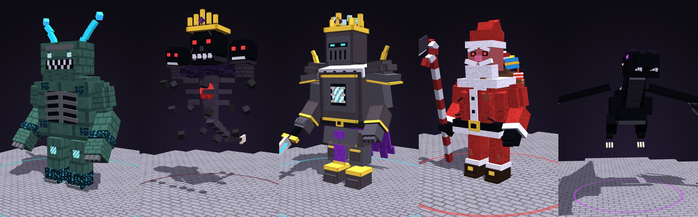</p>

**CBosses** adds 52 animated block-model bosses to Paper and Folia servers. Every boss is built from 85 to
205 display blocks, has its own entrance, its own attacks and its own death, and runs on a schedule, on a
season, right after a player finishes a CQuests chapter, or as the finale once the four legends have fallen. It
works on its own and alongside **CQuests**, and it has full **WorldGuard** support.

### [Open the 3D boss viewer](https://claude.ai/artifact/NbYXjJCKyRwZ2oTmETby7k)

Spin every boss around, play its entrance, each attack and its death, right in your browser. A copy of the viewer is
also in this repo at [`docs/viewer.html`](docs/viewer.html) (download and open it locally).

## Highlights

- **Hand-built models.** Every big boss is 150 blocks or more, and every block is there for a reason: faces painted
  pixel by pixel, armour with rims and rivets, torn hems, fur tufts, glowing cracks that follow the plates, and props
  that tell you who the boss is. Chapter bosses are smaller and simpler on purpose. Turn the fine detail down with
  `effects.model-detail` on a busy server.
- **A different entrance for every boss.** No two are the same: the Grand Augur's crown floats down onto his head last,
  Killer Claus climbs out of his own sack, Frostbottom stacks himself one snowball at a time, the Vault Mimic is just a
  chest until it stands up, and Clucksworth hatches out of a painted Easter egg.
- **A different death for every boss.** Each death has a flash and its own story: the Horseman's pumpkin is thrown, the
  Pharaoh pours away as sand, Fenrir freezes and shatters, the Void Walker is sucked into a point and bursts.
- **The finale.** Beat the Withered Tyrant, the Ender Wyrm, the Gale Sovereign and The Listener Below and **The Unmaker**
  wakes: a ten block tall, four-armed titan with a void heart, one great eye and a crown of orbiting shards.
- **Private chapter bosses.** A chapter boss appears where the player finished their quest and only exists for them:
  nobody else sees it, hears it, bumps into it or gets attacked. No boss ever breaks or places blocks.
- **Every word is yours.** All chat lines, titles, action bars, menus and the defeat broadcast are in `messages.yml`;
  boss names, titles and descriptions are in `bosses.yml`.
- **Attacks you can read.** Every ability has its own wind-up pose, effects and impact: slams, charges, dives, beams, meteors,
  spikes, sonic booms, minion waves and more. Flying bosses swoop and dive instead of jumping.
- **Chapter bosses.** A small, simple boss after every CQuests chapter (1 to 10), each built for its chapter's story.
- **Legend bosses.** The Listener Below (the Warden), the Withered Tyrant (the Wither), the Ender Wyrm (a flying Ender
  Dragon) and the Gale Sovereign (the Breeze) are the biggest fights in the plugin.
- **Seasonal bosses.** Three each for Halloween, Winter, Easter and Summer, including Killer Claus, Brain Freeze,
  Clucksworth and the Headless Horseman.
- **25 world bosses.** From the Grand Augur and the Crimson Oni to King Gloop, the slime king.
- **Built to stay light.** Models only update near players, movement uses client-side interpolation, particles and flying
  blocks have hard caps, and every cost can be tuned in `effects:`. Region schedulers make it Folia-safe.
- **Tested on real servers.** CI starts Paper 1.21.4, Paper 26.x and Folia, spawns every boss, runs each attack and plays
  each death, and fails on any error.

## Chapter bosses

When a player finishes a chapter in CQuests, CBosses counts down on their screen and their chapter boss appears in a
circle at their quest spot. It is their own private fight: other players do not see it, hear it or get hit by it,
and its minions only go after that player. If they lose or leave, it waits for `/cbosses chapter retry`. Pick a different boss per chapter under `chapter-bosses.bosses` in `config.yml`.

| Chapter | Boss | Health | Blocks |
|---|---|---|---|
| 1 | Brakka the Torchbearer | 500 | 107 |
| 2 | The Gate Shade | 700 | 110 |
| 3 | Sir Oakheart | 900 | 111 |
| 4 | The Vault Mimic | 1200 | 95 |
| 5 | The Crypt Knight | 1400 | 113 |
| 6 | Iron Tusk | 1600 | 115 |
| 7 | The Reef Hulk | 1800 | 105 |
| 8 | The Ember Knight | 2000 | 102 |
| 9 | The Choirmaster | 2200 | 93 |
| 10 | The Sculk Herald | 2500 | 85 |

<table>
<tr><td valign="top" width="33%">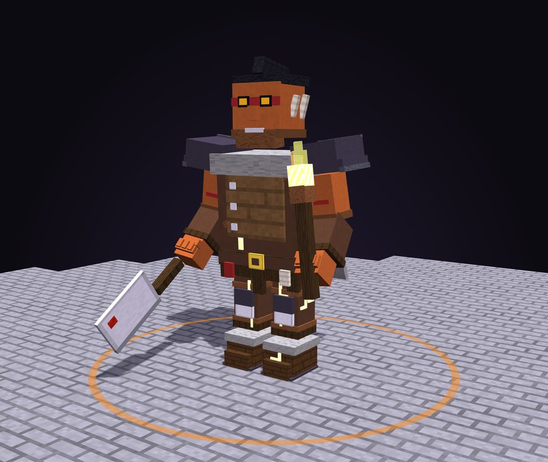<br><b>Brakka the Torchbearer</b><br><i>Burner of the Wanderers' Camp</i><br><sub><code>brakka</code> · 500 HP · 2 phases · Walks</sub><br><br>Chapter 1, The Wanderers' Camp: Brakka the bandit chief. A burly raider with a red bandana over his face, an eye patch, leather armour with a wolf-fur collar, a satchel of stolen loot, a crossbow slung on his back and a hatchet in each hand.<br><br><sub><b>Attacks:</b> Volley, Charge, Minions, Slam, Fire Ring</sub></td><td valign="top" width="33%">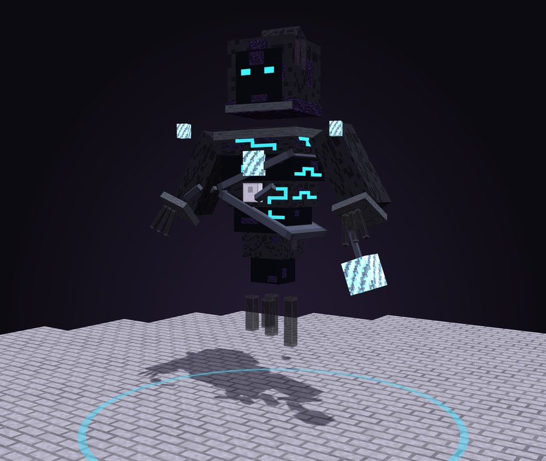<br><b>The Gate Shade</b><br><i>What Waits at the Gate</i><br><sub><code>gate_shade</code> · 700 HP · 2 phases · Hovers</sub><br><br>Chapter 2, Shadows at the Gate: a wraith made of shadow. A tall tattered hood with two white eyes burning in the dark, a ragged cloak that trails into wisps, long clawed hands, broken gate chains still locked round its wrists, and a cold lantern it carries to lure travellers off the road.<br><br><sub><b>Attacks:</b> Darkness, Blink, Minions, Pull</sub></td><td valign="top" width="33%">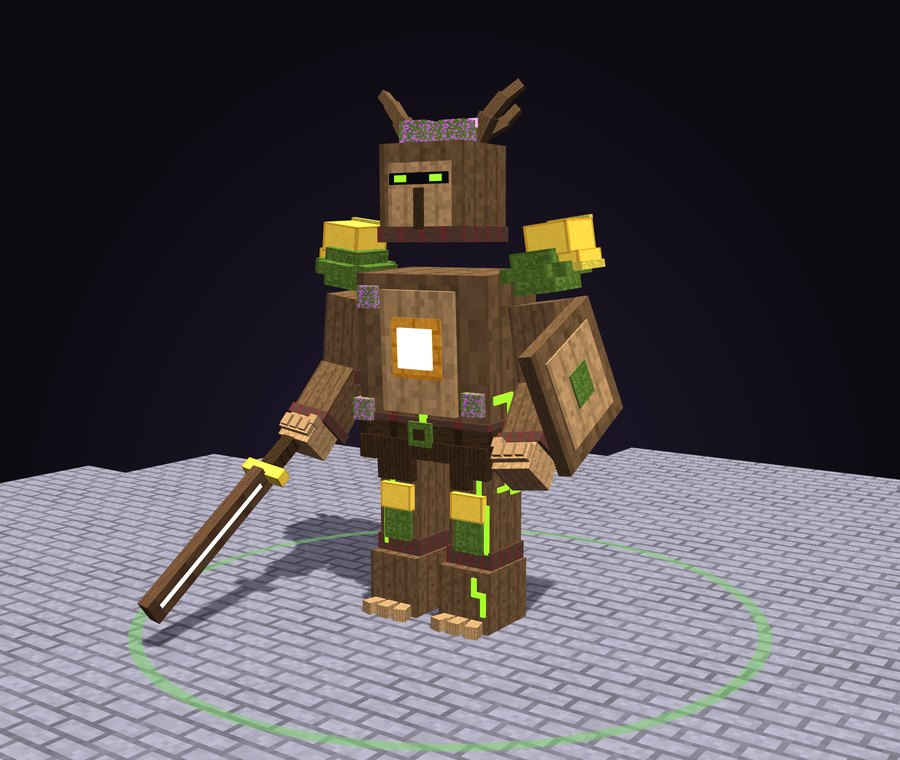<br><b>Sir Oakheart</b><br><i>The Elder's Champion</i><br><sub><code>oakheart</code> · 900 HP · 2 phases · Walks</sub><br><br>Chapter 3, The Elder's Charge: an old oak that woke up to protect the elder's grove. A trunk of bark with a hollow full of amber light for a face, mossy shoulders, branch arms that end in leafy fists, roots for feet, mushrooms on its side and a bird's nest in its crown of leaves.<br><br><sub><b>Attacks:</b> Quake, Minions, Spikes, Volley, Heal</sub></td></tr>
<tr><td valign="top" width="33%">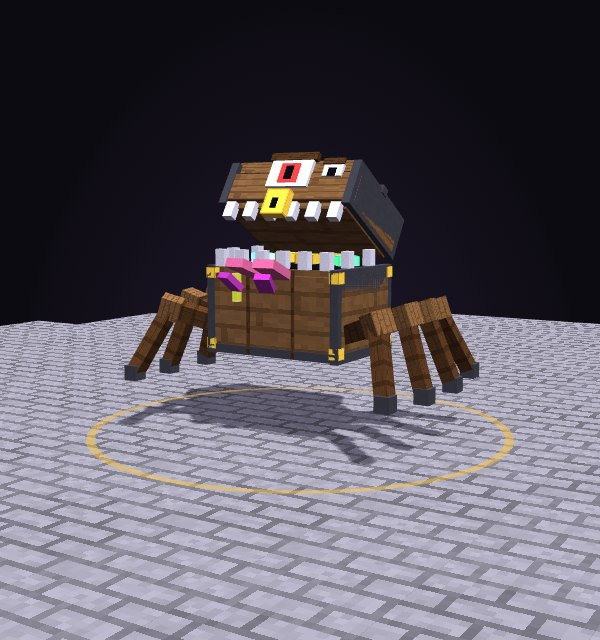<br><b>The Vault Mimic</b><br><i>The Fifth Key's Chest</i><br><sub><code>vault_mimic</code> · 1200 HP · 2 phases · Walks</sub><br><br>Chapter 4, The Five Keys: the fifth key's chest was never a chest. A wooden trunk with iron banding and a gold lock that opens into a mouth of teeth and a long tongue, one big eye in the lid, gold and gems spilling out, and crab legs that carry it sideways across the vault.<br><br><sub><b>Attacks:</b> Leap, Minions, Volley, Slam</sub></td><td valign="top" width="33%">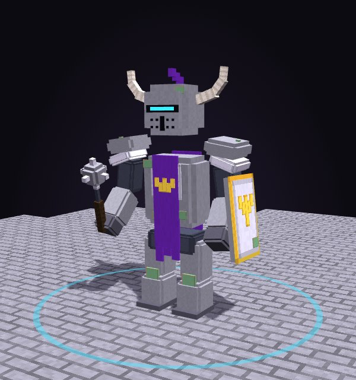<br><b>The Crypt Knight</b><br><i>First to Answer the King</i><br><sub><code>crypt_knight</code> · 1400 HP · 2 phases · Walks</sub><br><br>Chapter 5, The King Wakes: the first knight to answer the king. Rusted iron plate gone green at the joints, a torn purple tabard with the king's sign, a horned helm with a slit that glows, a battered tower shield and a spiked flail on a chain.<br><br><sub><b>Attacks:</b> Minions, Slam, Heal, Skulls, Charge</sub></td><td valign="top" width="33%">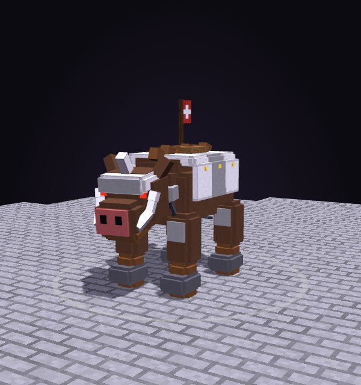<br><b>Iron Tusk</b><br><i>The War Boar</i><br><sub><code>iron_tusk</code> · 1600 HP · 2 phases · Walks</sub><br><br>Chapter 6, The Iron Tusk: a war boar the smiths armoured for the raiders. Bristly brown hide, iron plates riveted down its back, a spiked iron face guard, two tusks capped in iron, a chain dragging from its collar and a little war banner on its saddle.<br><br><sub><b>Attacks:</b> Charge, Quake, Roar, Slam, Fire Ring</sub></td></tr>
<tr><td valign="top" width="33%">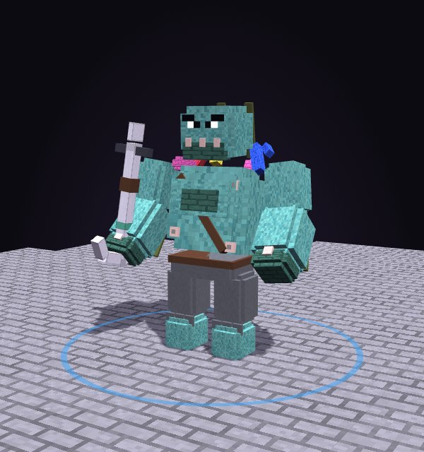<br><b>The Reef Hulk</b><br><i>Where the Reef Grew</i><br><sub><code>reef_hulk</code> · 1800 HP · 2 phases · Walks</sub><br><br>Chapter 7, Tides of the Drowned: a drowned brute that has lain on the reef so long the reef grew on it. Pale blue-green skin, coral growing out of its shoulders and back in four colours, barnacles, kelp hanging off its arms, glowing sea-lantern eyes, and a ship's anchor for a club.<br><br><sub><b>Attacks:</b> Minions, Pull, Slam, Shockwave</sub></td><td valign="top" width="33%">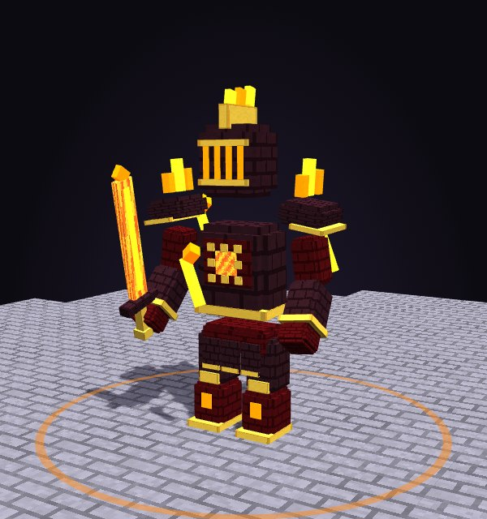<br><b>The Ember Knight</b><br><i>Champion of the Ember Court</i><br><sub><code>ember_knight</code> · 2000 HP · 2 phases · Walks</sub><br><br>Chapter 8, The Ember Court: the court's champion. Plate armour forged from nether brick and gold, the visor a grille of fire, a mantle of flame on the shoulders, three blaze rods turning round him and a sword whose blade is a bar of fire.<br><br><sub><b>Attacks:</b> Slam, Minions, Charge, Fire Ring, Breath</sub></td><td valign="top" width="33%">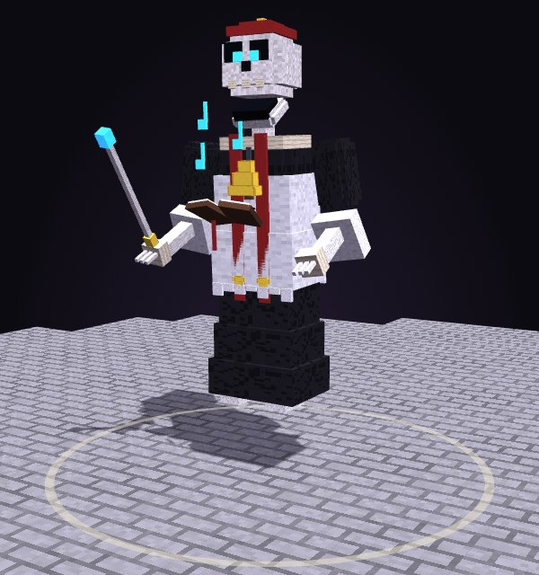<br><b>The Choirmaster</b><br><i>Conductor of the Bone Choir</i><br><sub><code>choirmaster</code> · 2200 HP · 3 phases · Hovers</sub><br><br>Chapter 9, The Bone Choir: the skeleton who leads the choir of the dead. A tall thin skeleton in a black choir robe with a white surplice and a red stole, a bell hanging round its neck, a hymn book floating open in front of it and a long conductor's baton tipped with a soul flame; its jaw hangs open mid-note.<br><br><sub><b>Attacks:</b> Minions, Darkness, Skulls, Shockwave, Sonic Boom</sub></td></tr>
<tr><td valign="top" width="33%">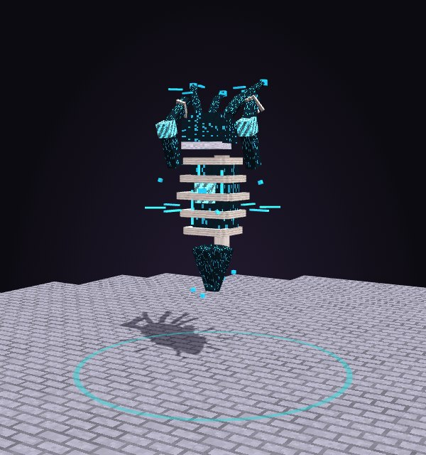<br><b>The Sculk Herald</b><br><i>It Wakes the Listener</i><br><sub><code>sculk_herald</code> · 2500 HP · 2 phases · Hovers</sub><br><br>Chapter 10, The Listener Below: the thing that wakes the Listener. A floating mass of sculk shaped like a ribcage with a shrieker for a mouth, sensor tendrils sweeping the air, soul-blue light pulsing from its veins and two long clawed arms; it has no eyes, it hears you.<br><br><sub><b>Attacks:</b> Darkness, Minions, Sonic Boom, Charge, Pull</sub></td></tr>
</table>


## The finale

When the Withered Tyrant, the Ender Wyrm, the Gale Sovereign and The Listener Below have all been beaten (in any order, by anyone),
the whole server is warned and The Unmaker wakes at the main arena a minute later. `/cbosses finale` shows how far
the server is, `/cbosses finale wake` starts it now and `/cbosses finale reset` starts over. Change the bosses, the
delay and the arena under `finale:` in `config.yml`.

<table>
<tr><td valign="top" width="33%">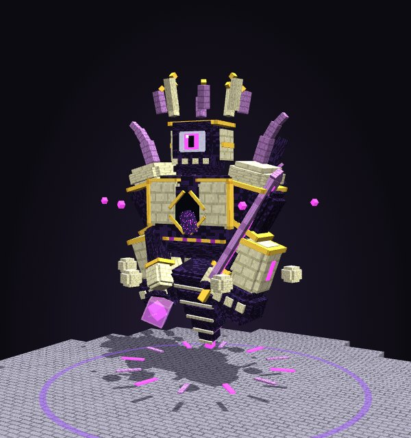<br><b>THE UNMAKER</b><br><i>Heart of the Void</i><br><sub><code>the_unmaker</code> · 6000 HP · 5 phases · Hovers</sub><br><br>The finale. Wakes once the Withered Tyrant, the Ender Wyrm, the Gale Sovereign and The Listener Below have all been beaten. A floating titan of obsidian armoured in end-stone plates trimmed in gold. One great eye with a purple iris; a crown of eight shards turning over its head; a void heart in a diamond-shaped opening in its chest; four arms: two huge gauntleted fists above, a void blade and an end-crystal orb below; two blade fins on its back; no legs, its body ends in a trailing tail of stone plates over a rune circle on the ground.<br><br><sub><b>Attacks:</b> Slam, Charge, Orbs, Meteor, Quake, Sonic Boom, Pull, Darkness, Lightning, Blink, Minions</sub></td></tr>
</table>


<p align="center">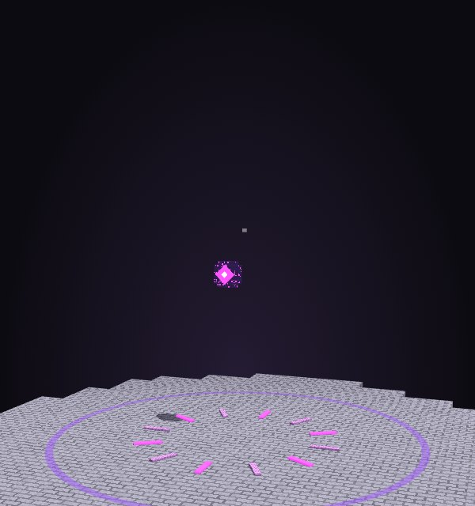 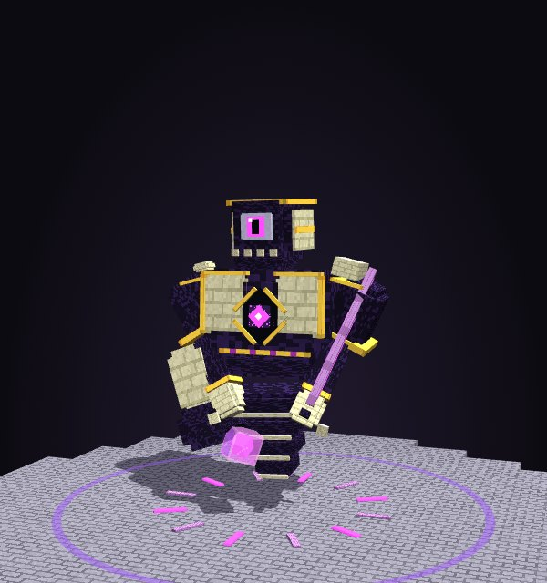 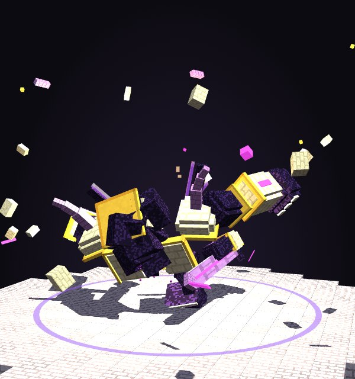</p>
<p align="center"><sub>The void heart lights alone in the air, the four arms swing in, and the end: the arms torn away before it bursts.</sub></p>

## Legend bosses

<table>
<tr><td valign="top" width="33%">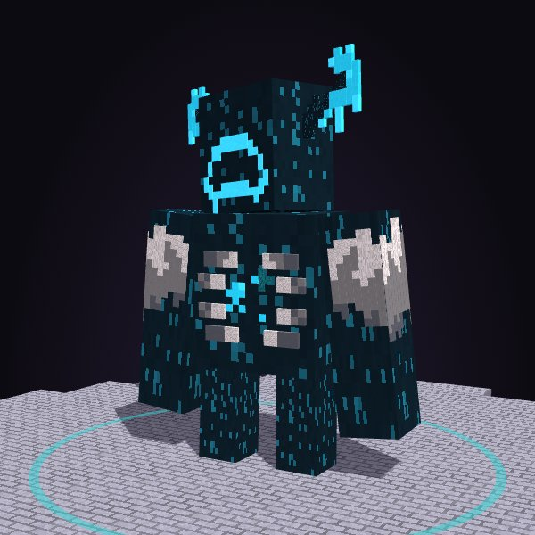<br><b>THE LISTENER BELOW</b><br><i>It Hears Your Heartbeat</i><br><sub><code>the_listener</code> · 3600 HP · 4 phases · Walks</sub><br><br>The warden of the deep dark grown into a legend: a towering dark-teal brute with no eyes, a wide jaw full of bone teeth, two great sensor horns that glow at the tips, an open ribcage where souls burn in a pulsing heart, sculk spreading over its shoulders and back, and long arms ending in clawed fists laced with glowing veins. It finds you by sound.<br><br><sub><b>Attacks:</b> Slam, Darkness, Quake, Sonic Boom, Shockwave, Pull, Charge</sub></td><td valign="top" width="33%">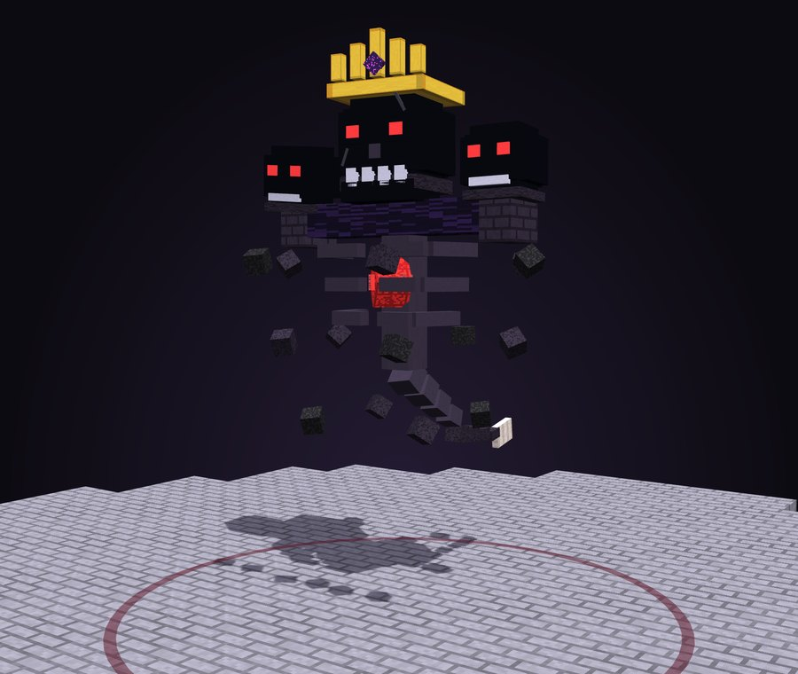<br><b>The Withered Tyrant</b><br><i>Three Skulls, One Hunger</i><br><sub><code>withered_tyrant</code> · 2600 HP · 3 phases · Hovers</sub><br><br>The Wither grown into a tyrant: three skulls on a bar of blackstone set with bone spikes, the middle one crowned in netherite and soul gems, a ribcage of dark bone with soul fire burning inside, a long spine that curls into a tail of flame, tattered black banners hanging from the bar and wither skulls circling it like moons.<br><br><sub><b>Attacks:</b> Skulls, Minions, Charge, Shockwave, Darkness, Meteor, Dive</sub></td><td valign="top" width="33%">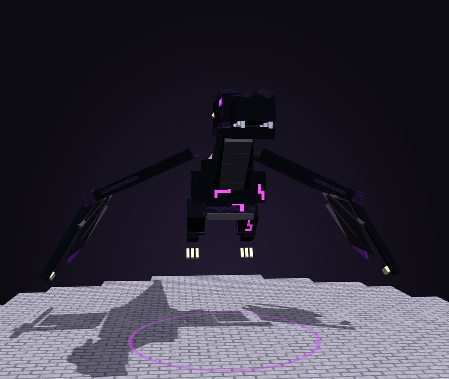<br><b>Vorthax the Ender Wyrm</b><br><i>Dragon of the Outer Dark</i><br><sub><code>ender_wyrm</code> · 3000 HP · 4 phases · Flies</sub><br><br>A dragon of the End: a black body armoured in dark grey scales, a ridge of plates from its horns to the spade of its tail, purple eyes that glow, a long jaw lined with teeth, great membrane wings on finger bones that beat as it moves, and end crystals set into its chest like a heart.<br><br><sub><b>Attacks:</b> Breath, Charge, Minions, Slam, Dive, Orbs, Meteor, Levitate</sub></td></tr>
<tr><td valign="top" width="33%">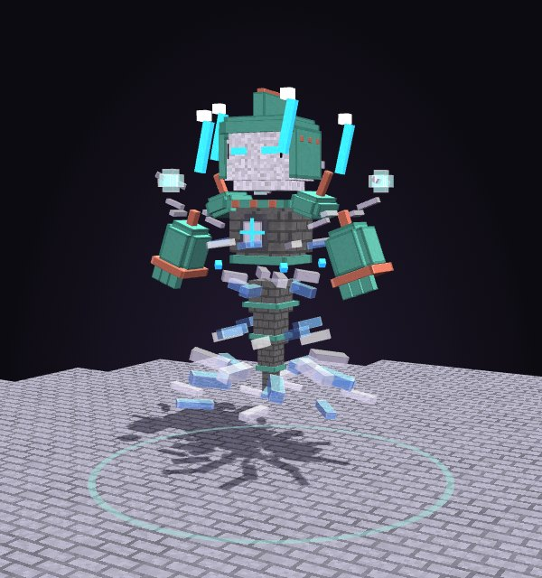<br><b>The Gale Sovereign</b><br><i>Lord of the Trial Winds</i><br><sub><code>gale_sovereign</code> · 2800 HP · 4 phases · Hovers</sub><br><br>A breeze that grew up in a trial chamber and took its armour: a pale head in an oxidized copper helm with a visor slit that glows, a heavy iron core where its heart should be, a body that is nothing but a spinning column of wind in three bands, breeze rods circling its head and two copper gauntlets that float where its hands would be.<br><br><sub><b>Attacks:</b> Pull, Shockwave, Orbs, Charge, Levitate, Volley, Dive</sub></td></tr>
</table>


## World bosses

These take turns as the weekly public boss at your arena.

<table>
<tr><td valign="top" width="33%">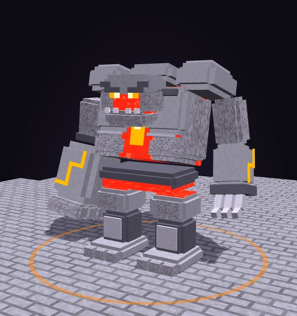<br><b>Slagheart</b><br><i>The Molten Colossus</i><br><sub><code>slagheart</code> · 2000 HP · 2 phases · Walks</sub><br><br>A hunched stone colossus with one oversized fist. Its body is a molten core held in by grey stone plates; the gaps between the plates glow, so the cracks follow the armour instead of being random.<br><br><sub><b>Attacks:</b> Slam, Quake, Meteor, Charge, Fire Ring, Shockwave</sub></td><td valign="top" width="33%">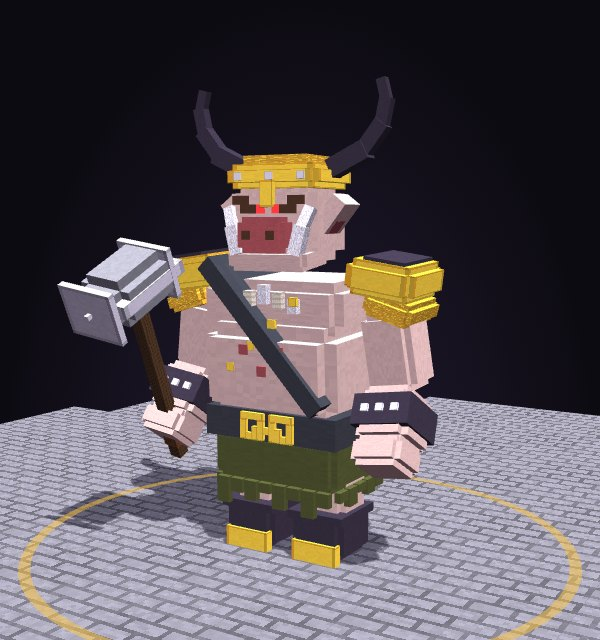<br><b>Warlord Gruk</b><br><i>Gold-Hungry Tyrant of the Bastion</i><br><sub><code>warlord_gruk</code> · 1700 HP · 3 phases · Walks</sub><br><br>A pot-bellied piglin warlord: gold half helm with iron horns, a buckled war belt over a ragged green kilt, gold pauldrons, studded bracers and a stone maul bound with iron.<br><br><sub><b>Attacks:</b> Slam, Charge, Minions, Quake, Leap, Shockwave</sub></td><td valign="top" width="33%">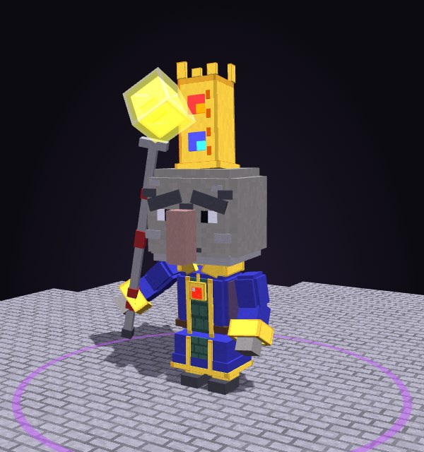<br><b>The Grand Augur</b><br><i>King of the Illagers</i><br><sub><code>grand_augur</code> · 1700 HP · 2 phases · Walks</sub><br><br>The illager king-sorcerer: a huge grey head with a heavy dark unibrow and a long nose, a towering gold crown set with a red and a blue gem, a short blue robe with gold edging, a stand-up gold collar and a ruby amulet, big square gold cuffs, and a grey staff banded in red with a gold crystal floating over it.<br><br><sub><b>Attacks:</b> Blink, Minions, Sonic Boom, Spikes, Levitate, Darkness</sub></td></tr>
<tr><td valign="top" width="33%">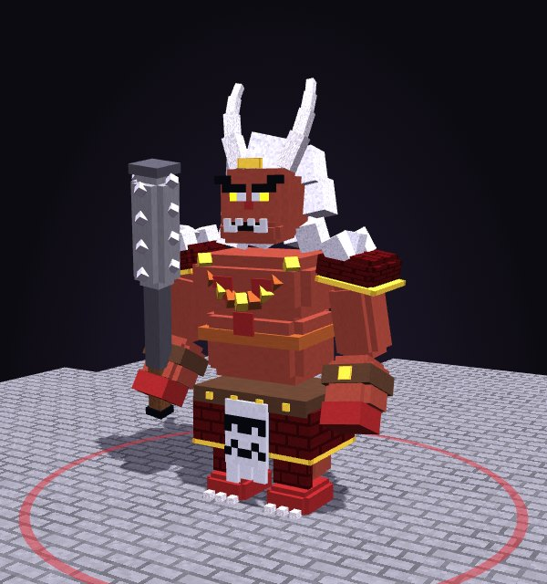<br><b>The Crimson Oni</b><br><i>Warlord of the Red Mountain</i><br><sub><code>crimson_ronin</code> · 1800 HP · 2 phases · Walks</sub><br><br>A red oni warlord: a snarling face framed by a white mane and two ivory horns, a gold rope of beads, a white loincloth with a black tooth pattern, gold-trimmed armour skirt and a huge studded iron club.<br><br><sub><b>Attacks:</b> Slam, Charge, Quake, Roar, Leap, Fire Ring</sub></td><td valign="top" width="33%">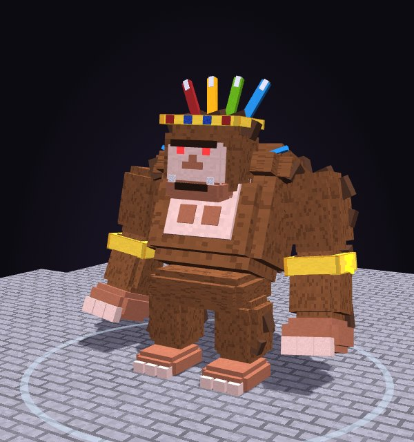<br><b>Thunderback</b><br><i>The Storm Ape</i><br><sub><code>thunderback</code> · 2100 HP · 2 phases · Walks</sub><br><br>A giant storm ape that walks on its knuckles: shaggy red-brown fur, a bare tan chest and face, gold arm rings stamped with a lightning glyph and a chieftain's feather crown.<br><br><sub><b>Attacks:</b> Slam, Quake, Lightning, Charge, Leap, Shockwave</sub></td><td valign="top" width="33%">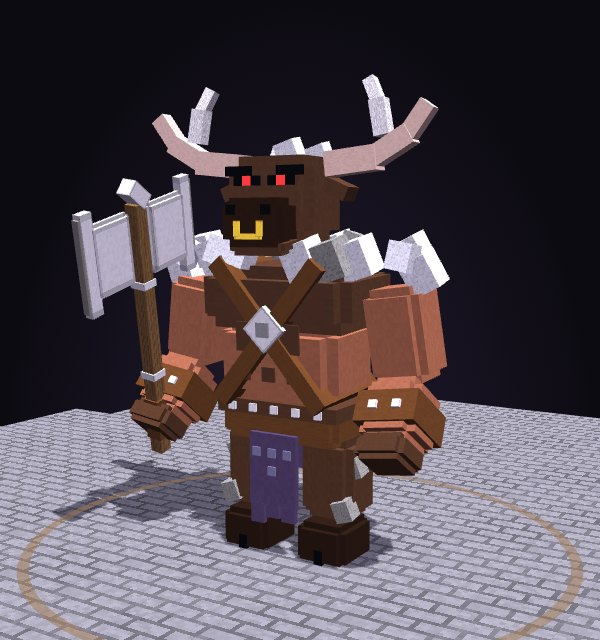<br><b>Gorehorn</b><br><i>Champion of the Pit</i><br><sub><code>gorehorn</code> · 2000 HP · 2 phases · Walks</sub><br><br>A minotaur pit champion: dark brown bull head with frosted-white horns and a gold nose ring, snow-white fur over the shoulders, a leather harness, a blue loincloth and a double-headed axe.<br><br><sub><b>Attacks:</b> Charge, Slam, Quake, Roar, Shockwave, Leap</sub></td></tr>
<tr><td valign="top" width="33%">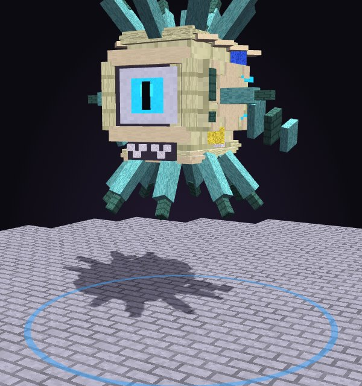<br><b>The Abyssal Eye</b><br><i>Sentinel of the Drowned Temple</i><br><sub><code>abyssal_eye</code> · 1700 HP · 2 phases · Hovers</sub><br><br>An ancient deep-sea sentinel: a stone-armoured fish body with one great eye, prismarine spines that turn slowly around it, fins and a forked tail.<br><br><sub><b>Attacks:</b> Orbs, Pull, Charge, Sonic Boom, Frost, Shockwave</sub></td><td valign="top" width="33%">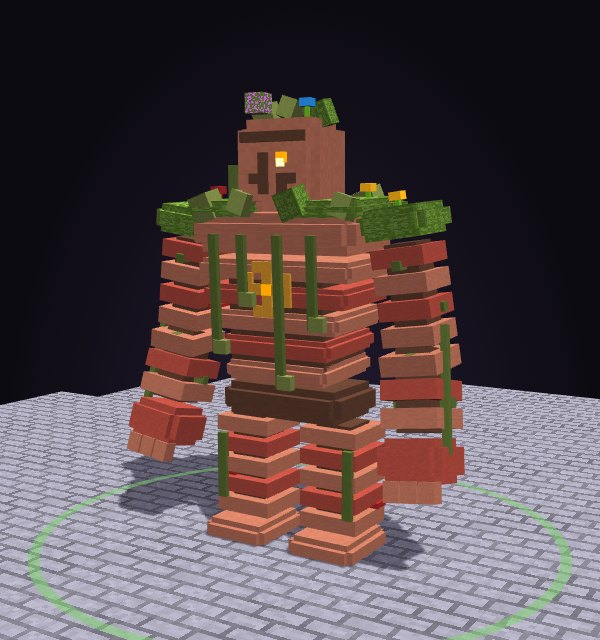<br><b>Overgrowth</b><br><i>The Guardian the Jungle Took</i><br><sub><code>overgrowth</code> · 1900 HP · 2 phases · Walks</sub><br><br>A ruined terracotta guardian that the jungle took back: banded clay limbs made of stacked rings, moss on the shoulders, vines hanging down its chest and arms, one amber eye in a cracked head.<br><br><sub><b>Attacks:</b> Slam, Quake, Minions, Pull, Spikes, Poison</sub></td><td valign="top" width="33%">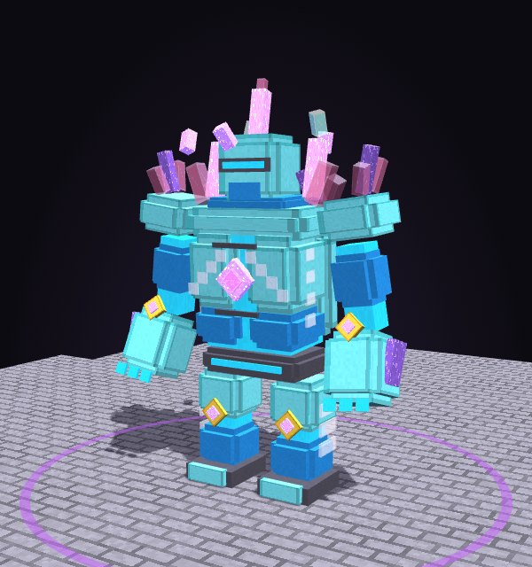<br><b>The Prism Sentinel</b><br><i>Cut From the Heart of the Mountain</i><br><sub><code>prism_sentinel</code> · 1900 HP · 2 phases · Walks</sub><br><br>A crystal golem cut from diamond and amethyst: faceted plates over a glowing cyan core, a gem set in its chest, crystal clusters growing from the shoulders and a visor slit for eyes.<br><br><sub><b>Attacks:</b> Slam, Sonic Boom, Volley, Heal, Orbs, Shockwave</sub></td></tr>
<tr><td valign="top" width="33%">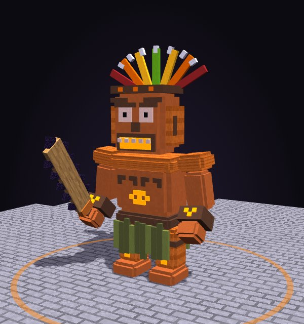<br><b>The Tiki Warden</b><br><i>Idol of the Burning Isle</i><br><sub><code>tiki_warden</code> · 1800 HP · 2 phases · Walks</sub><br><br>A volcanic tiki idol come to life: a huge carved mask for a head with a lit mouth, orange stone body cut with glyph bands, a feathered headdress and a jagged obsidian-edged war blade.<br><br><sub><b>Attacks:</b> Meteor, Slam, Charge, Quake, Fire Ring, Shockwave</sub></td><td valign="top" width="33%">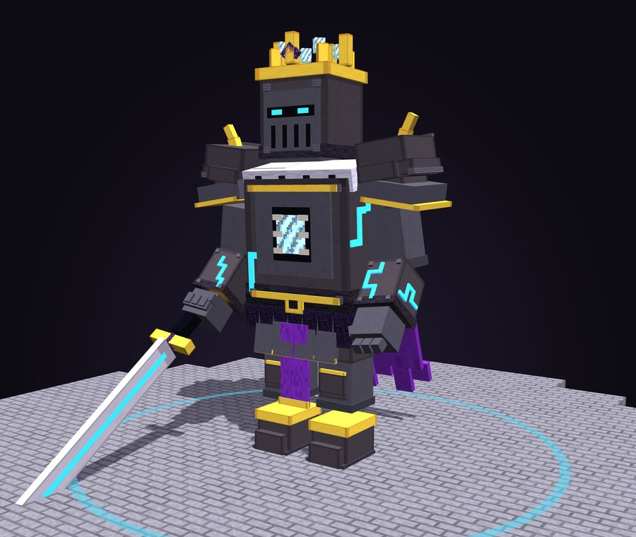<br><b>THE HOLLOW KING</b><br><i>The King Wakes</i><br><sub><code>hollow_king</code> · 2200 HP · 4 phases · Walks</sub><br><br>A skeleton king: bone-white ribs and skull, a tall iron crown set with soul gems, a torn royal cloak of deep purple with gold trim, gilded pauldrons and a long soul-fire greatsword.<br><br><sub><b>Attacks:</b> Slam, Minions, Charge, Skulls, Darkness, Shockwave</sub></td><td valign="top" width="33%">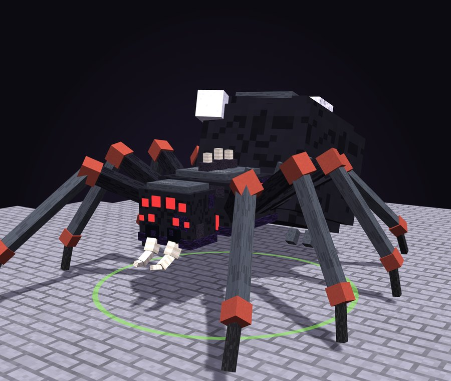<br><b>The Broodmother</b><br><i>Queen of the Deep Webs</i><br><sub><code>broodmother</code> · 1400 HP · 3 phases · Walks</sub><br><br>The spider queen: a black, hairy body banded in venom green, a swollen abdomen marked with a red hourglass, eight glowing eyes in two rows, long jointed legs and dripping fangs.<br><br><sub><b>Attacks:</b> Minions, Leap, Pull, Poison, Charge, Spikes</sub></td></tr>
<tr><td valign="top" width="33%">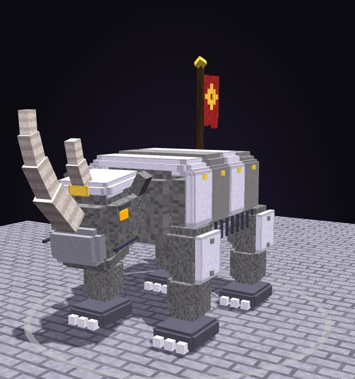<br><b>The Ironhide Behemoth</b><br><i>War Beast of the Raid</i><br><sub><code>ironhide_behemoth</code> · 2400 HP · 3 phases · Walks</sub><br><br>A war rhino in riveted iron barding: a great nose horn and a second smaller one, plated neck, overlapping back plates, chain fringe, a war banner on its back and glowing furnace eyes.<br><br><sub><b>Attacks:</b> Charge, Quake, Roar, Slam, Shockwave, Leap</sub></td><td valign="top" width="33%">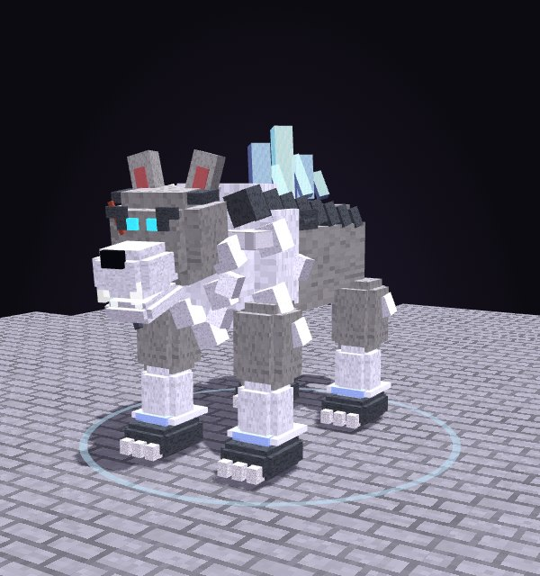<br><b>Fenrir</b><br><i>The Wolf That Swallows the Moon</i><br><sub><code>fenrir</code> · 1500 HP · 3 phases · Walks</sub><br><br>A giant frost wolf: a thick grey-white coat in layered tufts, a snarling muzzle with ice fangs, blue glowing eyes, a broken iron chain collar and ice crystals growing out of its back.<br><br><sub><b>Attacks:</b> Frost, Minions, Charge, Leap, Shockwave, Roar</sub></td><td valign="top" width="33%">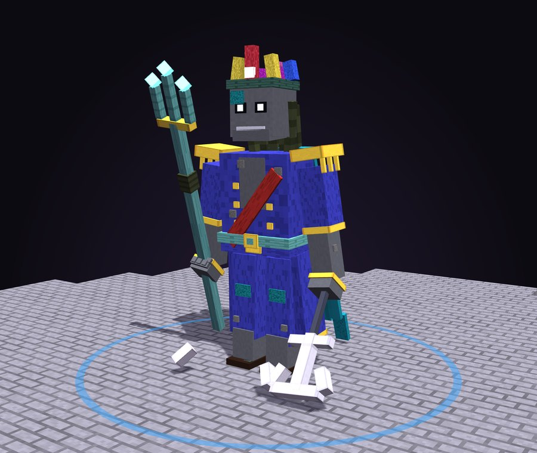<br><b>The Tide Tyrant</b><br><i>Drowned King of the Sunken Fleet</i><br><sub><code>tide_tyrant</code> · 1500 HP · 3 phases · Walks</sub><br><br>A drowned sea king: teal scaled skin, a coral and pearl crown, a barnacled breastplate of oxidised copper, a kelp cape, a fin crest and a glowing trident.<br><br><sub><b>Attacks:</b> Orbs, Pull, Charge, Shockwave, Frost, Minions</sub></td></tr>
<tr><td valign="top" width="33%">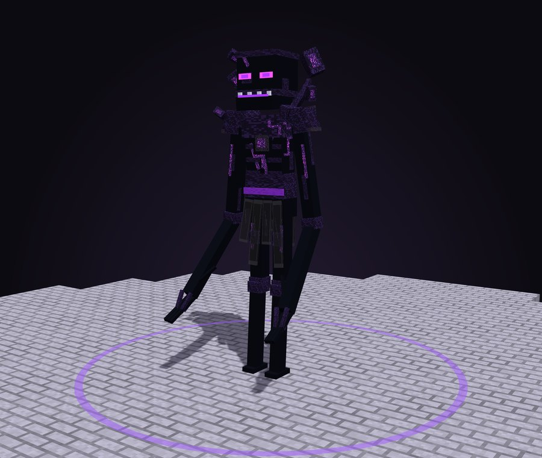<br><b>The Void Walker</b><br><i>It Was Never Really Here</i><br><sub><code>void_walker</code> · 1400 HP · 3 phases · Walks</sub><br><br>A towering ender lord: thin black limbs, a plated obsidian torso cracked with purple light, a flowing tattered cowl, purple eyes and a halo of floating end-stone shards.<br><br><sub><b>Attacks:</b> Blink, Orbs, Darkness, Pull, Sonic Boom, Levitate</sub></td><td valign="top" width="33%">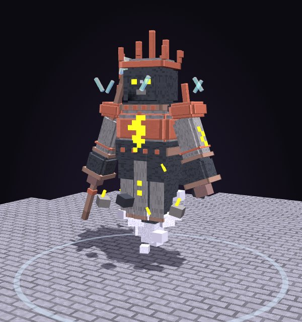<br><b>The Storm Herald</b><br><i>Voice of the Thunderhead</i><br><sub><code>storm_herald</code> · 1200 HP · 3 phases · Walks</sub><br><br>A floating storm caller: a hooded figure in grey storm cloth with copper armour that crackles, lightning rods for a crown, a long lightning-rod staff and a ring of spinning cloud stones; it has no legs, its robe ends in a swirl of cloud.<br><br><sub><b>Attacks:</b> Lightning, Orbs, Pull, Blink, Meteor, Levitate</sub></td><td valign="top" width="33%">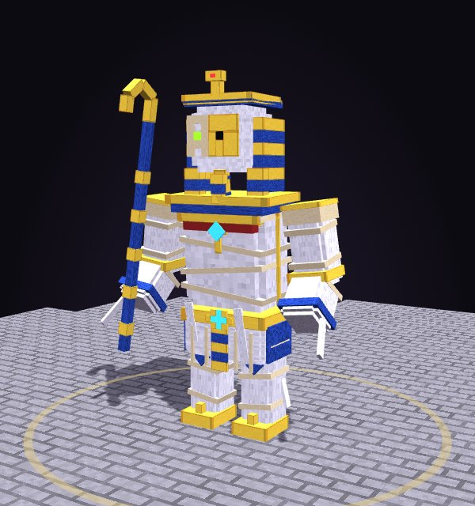<br><b>Pharaoh Ankhamun</b><br><i>Risen from the Buried Temple</i><br><sub><code>pharaoh</code> · 1600 HP · 3 phases · Walks</sub><br><br>A mummy pharaoh: linen-wrapped limbs with loose strips, a striped gold and lapis headdress with a cobra crest, a broad jewelled collar, a gold mask over one half of the face and a crook staff.<br><br><sub><b>Attacks:</b> Minions, Blink, Darkness, Spikes, Poison, Orbs</sub></td></tr>
<tr><td valign="top" width="33%">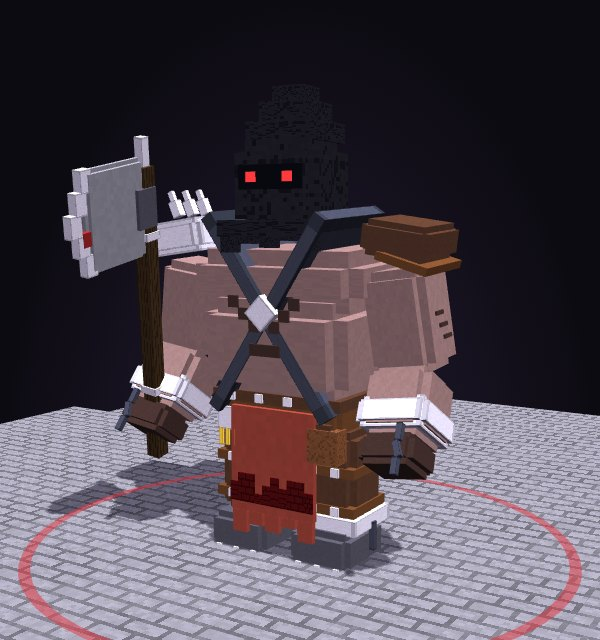<br><b>The Executioner</b><br><i>Axe of the Woodland Mansion</i><br><sub><code>executioner</code> · 1500 HP · 3 phases · Walks</sub><br><br>A giant headsman: a black hood with a single eye slit, a bare grey chest crossed with chains, a blood-red apron over leather, iron manacles on its wrists and a huge crescent axe.<br><br><sub><b>Attacks:</b> Slam, Charge, Quake, Pull, Minions, Shockwave</sub></td><td valign="top" width="33%">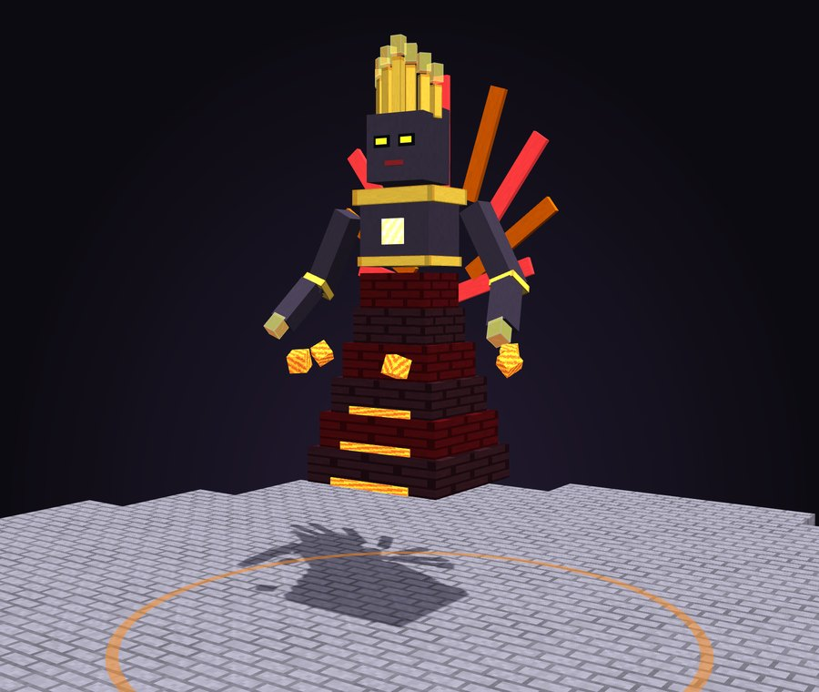<br><b>The Ember Queen</b><br><i>Queen of the Ember Court</i><br><sub><code>ember_queen</code> · 2000 HP · 3 phases · Hovers</sub><br><br>A fire witch queen: a gown of magma and nether brick flaring into flame at the hem, a black corset with gold lacing, a crown of blaze rods, burning hair and a sceptre topped with a fire orb.<br><br><sub><b>Attacks:</b> Meteor, Minions, Blink, Fire Ring, Breath, Orbs</sub></td><td valign="top" width="33%">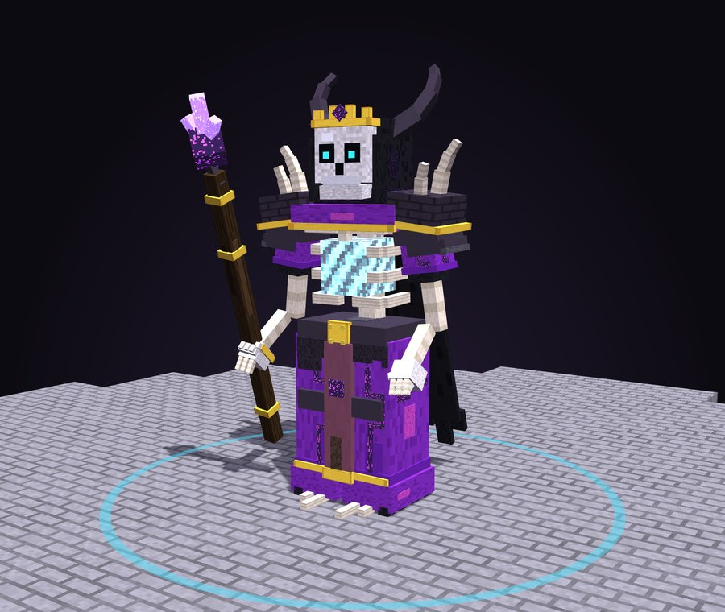<br><b>The Gravelord</b><br><i>Lord of the Restless Dead</i><br><sub><code>gravelord</code> · 1600 HP · 3 phases · Walks</sub><br><br>A necromancer lord: a skull face under a deep hood, a mantle of bone and black feathers, robes stitched with green soul thread, a lantern of trapped souls on a chain and a scythe-staff.<br><br><sub><b>Attacks:</b> Minions, Darkness, Pull, Skulls, Spikes, Shockwave</sub></td></tr>
<tr><td valign="top" width="33%">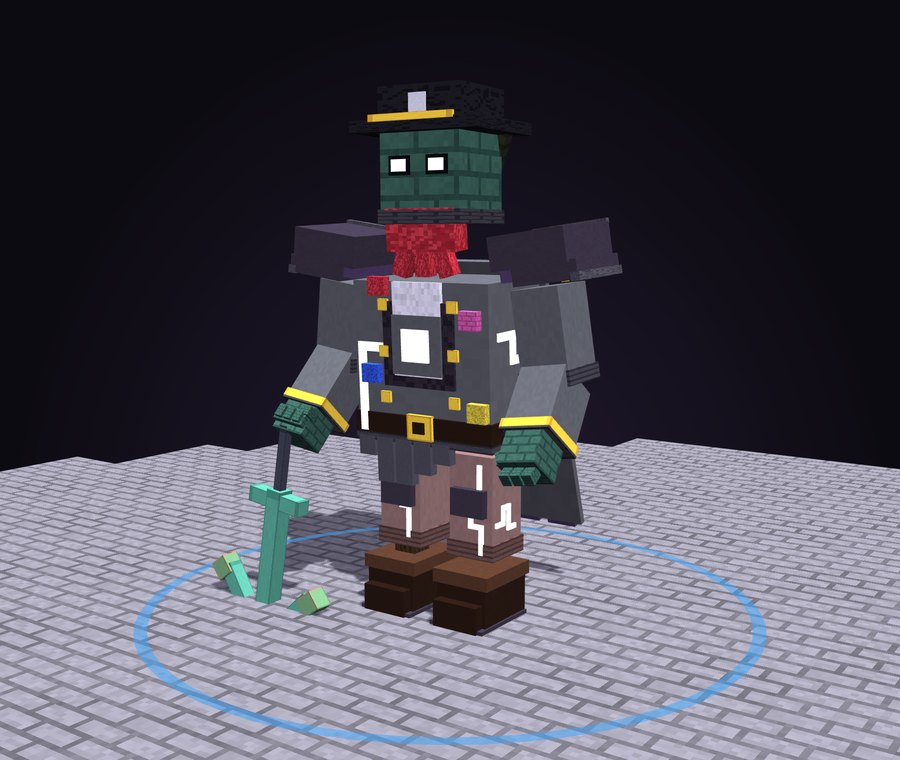<br><b>Captain Brine</b><br><i>Captain of the Drowned</i><br><sub><code>captain_brine</code> · 1900 HP · 2 phases · Walks</sub><br><br>A ghost pirate captain: a big tricorn hat with a skull badge, a red coat with gold buttons and cuffs, a peg leg, a hook hand, a cutlass and a green ghostly glow coming off him.<br><br><sub><b>Attacks:</b> Minions, Charge, Pull, Meteor, Shockwave, Frost</sub></td><td valign="top" width="33%">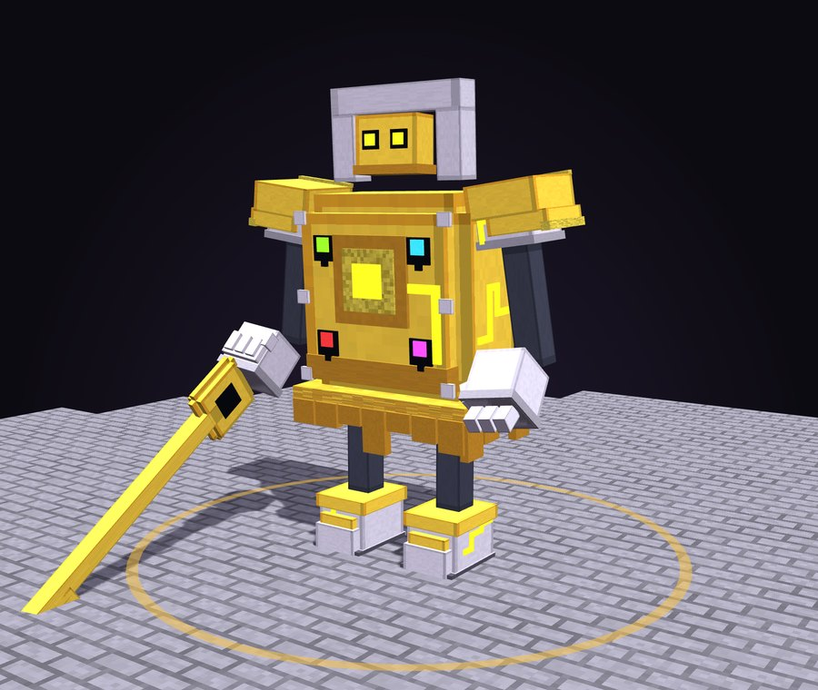<br><b>The Keywarden</b><br><i>Guardian of the Five Keys</i><br><sub><code>keywarden</code> · 1800 HP · 2 phases · Walks</sub><br><br>A clockwork vault guardian: a brass and copper body riveted together, a round glass dome head with a glowing gear inside, a giant wind-up key turning in its back, piston arms and a lock-plate shield.<br><br><sub><b>Attacks:</b> Slam, Charge, Minions, Darkness, Shockwave, Orbs</sub></td><td valign="top" width="33%">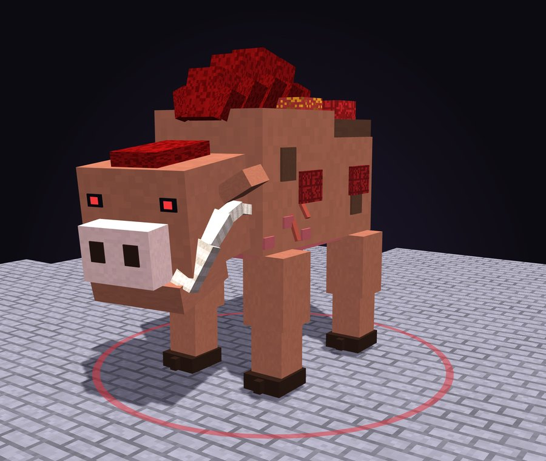<br><b>Bloodtusk</b><br><i>The Crimson Charger</i><br><sub><code>bloodtusk</code> · 1800 HP · 3 phases · Walks</sub><br><br>A hoglin war beast: a massive head with four tusks, a mane of red bristle, a spiked iron saddle with a war drum, chain barding and bone trophies, and hooves that split the ground.<br><br><sub><b>Attacks:</b> Charge, Quake, Roar, Slam, Minions, Shockwave</sub></td></tr>
<tr><td valign="top" width="33%">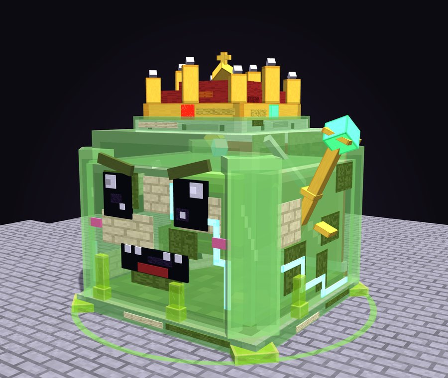<br><b>King Gloop</b><br><i>Monarch of the Swamp</i><br><sub><code>king_gloop</code> · 1600 HP · 3 phases · Walks</sub><br><br>The slime king. Bounces, quakes the arena and splits into a crowd of little slimes.<br><br><sub><b>Attacks:</b> Leap, Quake, Minions, Poison, Spikes, Shockwave</sub></td></tr>
</table>


## Seasonal bosses

A seasonal boss takes the weekly slot while its season is on. Seasons switch on by date, by command, or by following
the season CQuests has on.

<table>
<tr><td valign="top" width="33%">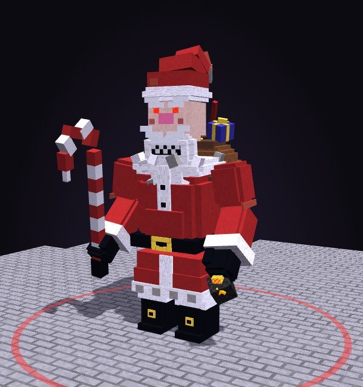<br><b>Killer Claus</b><br><i>He Knows If You've Been Bad</i><br><sub><code>killer_claus</code> · 2000 HP · 3 phases · Walks</sub><br><br>Santa gone bad: a red coat with matted white fur, a beard stained grey at the tips, a crooked hat, glowing red eyes and a grin full of teeth. He drags a sack of stolen presents on his back, swings a giant candy-cane hook and keeps a burning lump of coal for the naughty.<br><br><sub><b>Attacks:</b> Minions, Quake, Meteor, Pull, Gifts, Frost</sub></td><td valign="top" width="33%">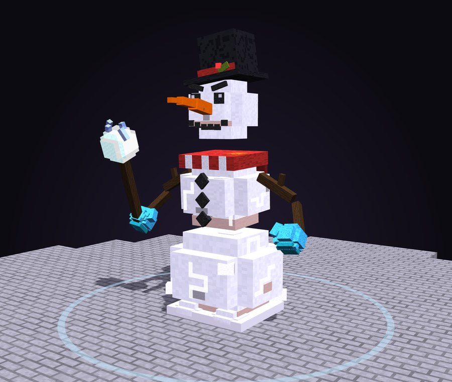<br><b>Frostbottom</b><br><i>The Snowman With a Grudge</i><br><sub><code>frostbottom</code> · 1600 HP · 3 phases · Walks</sub><br><br>A snow golem grown huge and grumpy: three packed snowballs, a cracked ice face with coal eyes that glow cold blue, a carrot nose, stick arms with twig fingers, a striped scarf, a dented bucket for a hat and icicles hanging off every ledge. It slides around on a patch of ice instead of walking.<br><br><sub><b>Attacks:</b> Frost, Minions, Volley, Charge, Gifts, Shockwave</sub></td><td valign="top" width="33%">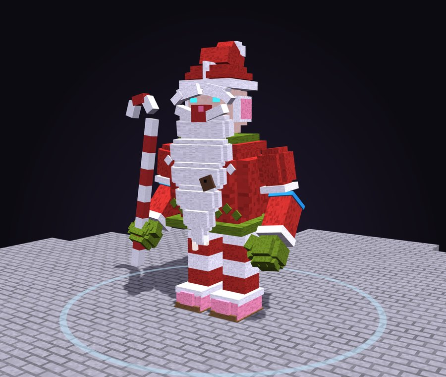<br><b>Old Man Winter</b><br><i>The Blizzard Returns</i><br><sub><code>old_man_winter</code> · 1700 HP · 3 phases · Walks</sub><br><br>The spirit of winter as an old giant: an ice-blue robe embroidered with snowflakes, a mantle of white fur, a beard of icicles that reaches his belt, a crown of ice spikes and frozen breath. He leans on a frozen staff topped by a huge blue crystal and a lantern of cold light.<br><br><sub><b>Attacks:</b> Frost, Spikes, Minions, Levitate, Volley, Shockwave</sub></td></tr>
<tr><td valign="top" width="33%">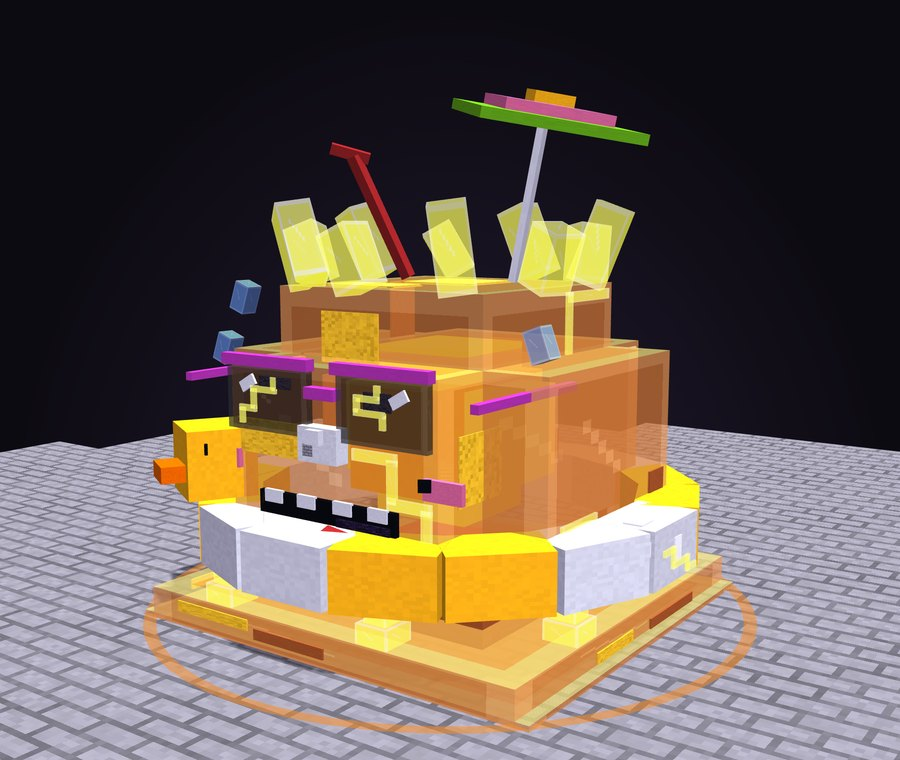<br><b>Sunscorch</b><br><i>Melting On Holiday</i><br><sub><code>sunscorch</code> · 1500 HP · 3 phases · Walks</sub><br><br>A grumpy sun on a pool float. Sets the arena on fire and cannonballs into players.<br><br><sub><b>Attacks:</b> Leap, Quake, Fire Ring, Volley, Meteor, Sprinkles</sub></td><td valign="top" width="33%">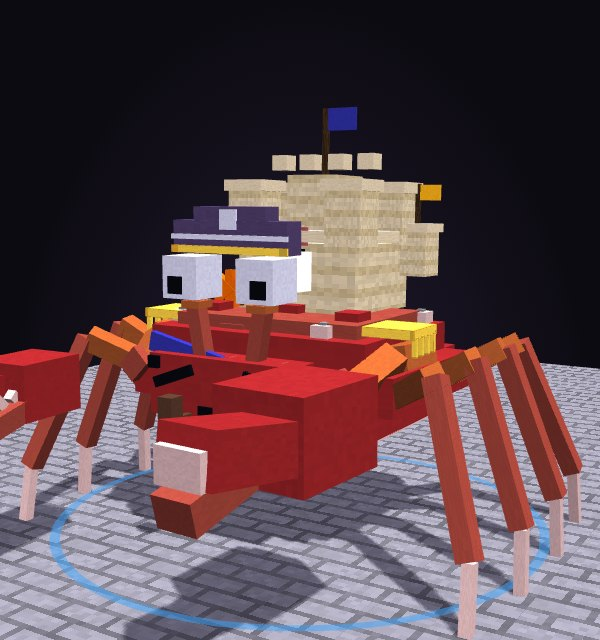<br><b>Admiral Pinchworth</b><br><i>Lord of the Sandcastle</i><br><sub><code>admiral_pinchworth</code> · 1500 HP · 3 phases · Walks</sub><br><br>A crab admiral. Pinches, scuttles sideways and pulls you in.<br><br><sub><b>Attacks:</b> Leap, Minions, Pull, Volley, Charge, Orbs</sub></td><td valign="top" width="33%">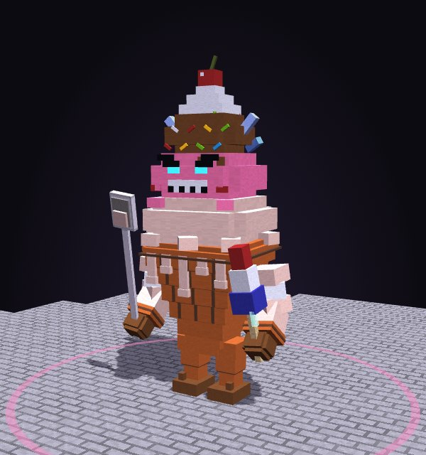<br><b>Brain Freeze</b><br><i>The Sundae Supreme</i><br><sub><code>brain_freeze</code> · 1800 HP · 2 phases · Walks</sub><br><br>A walking ice-cream cone with a headache: a waffle cone body, three scoops for a head (vanilla, strawberry with an angry face, chocolate with rows of sprinkles), whipped cream and a cherry, ice shards sticking out of its skull from the brain freeze. It swings a giant spoon and a rocket ice lolly.<br><br><sub><b>Attacks:</b> Sprinkles, Minions, Frost, Slam, Orbs, Shockwave</sub></td></tr>
<tr><td valign="top" width="33%"><br><b>Clucksworth</b><br><i>The Chicken That Came First</i><br><sub><code>clucksworth</code> · 1400 HP · 3 phases · Walks</sub><br><br>A huge hen dressed up for Easter and very angry about it: puffed white feathers with grey scale marks on the breast, a big red comb and wattle, an Easter bonnet with a pastel ribbon, a bandolier of painted eggs she throws like grenades, and feathered wings she slams the ground with.<br><br><sub><b>Attacks:</b> Eggs, Slam, Minions, Charge, Leap, Shockwave</sub></td><td valign="top" width="33%"><br><b>The Killer Bunny</b><br><i>Small, Fluffy, Merciless</i><br><sub><code>killer_bunny</code> · 900 HP · 3 phases · Walks</sub><br><br>A rabbit that has had enough of Easter: matted white fur, one ear torn and flopped over, red eyes, two huge buck teeth, a pink bow with a bell gone grubby, a leather strap with an iron pauldron, huge hind feet, a carrot as long as a sword and a basket of eggs it hurls.<br><br><sub><b>Attacks:</b> Eggs, Leap, Minions, Charge, Shockwave, Slam</sub></td><td valign="top" width="33%"><br><b>The Cocoa Colossus</b><br><i>The Egg That Fought Back</i><br><sub><code>cocoa_colossus</code> · 1700 HP · 2 phases · Walks</sub><br><br>A chocolate egg golem: a giant hollow egg with half its gold and purple foil still on, cracked open across the chest where a glowing caramel heart shows, arms and legs made of chocolate-bar squares and a smaller egg for a head with a jagged crack for a face.<br><br><sub><b>Attacks:</b> Slam, Quake, Minions, Orbs, Eggs, Shockwave</sub></td></tr>
<tr><td valign="top" width="33%"><br><b>The Great Gourd</b><br><i>Trick or Treat, Mostly Trick</i><br><sub><code>great_gourd</code> · 1500 HP · 3 phases · Walks</sub><br><br>A scarecrow whose pumpkin head came alive: a huge carved jack-o'-lantern lit from inside, a curled stem with leaves, a patched burlap shirt stuffed with straw that pokes out at the cuffs and collar, a rope belt, a tattered dark coat, a crow on its shoulder and a rusty pitchfork.<br><br><sub><b>Attacks:</b> Minions, Volley, Charge, Fire Ring, Meteor, Slam</sub></td><td valign="top" width="33%"><br><b>The Headless Horseman</b><br><i>Rider of All Hallows' Eve</i><br><sub><code>headless_horseman</code> · 1600 HP · 3 phases · Walks</sub><br><br>A headless rider on a nightmare horse: the horse is black with a bone mask and ribs showing, a mane and tail of fire and burning hooves, under a ragged purple caparison with orange trim. The rider wears a dark coat with a ruffled collar and a tattered cape; flames rise from his neck, he holds up his own carved jack-o'-lantern head in one hand and a long notched sabre in the other.<br><br><sub><b>Attacks:</b> Charge, Minions, Fire Ring, Meteor, Shockwave, Pull</sub></td><td valign="top" width="33%"><br><b>Hexmother Morwen</b><br><i>Brewer of a Thousand Curses</i><br><sub><code>hexmother</code> · 1200 HP · 3 phases · Walks</sub><br><br>A crone of a witch: green warty skin, a long hooked nose, wild grey hair, a tall bent hat with a buckle and a spider web, a ragged purple dress with potion bottles on the belt, a black cat riding her shoulder and a gnarled staff topped with a skull and a bubbling green cauldron-fire.<br><br><sub><b>Attacks:</b> Minions, Blink, Darkness, Orbs, Levitate, Heal</sub></td></tr>
</table>


<p align="center">  </p>
<p align="center"><sub>Clucksworth's egg, the hatch, and Killer Claus breaking apart.</sub></p>

## Evolving bosses and two-body bosses

After `evolve.after-seconds` in a fight, a boss may evolve (`evolve.chance`, or `evolve:` per boss): it hits
harder, moves faster and heals a little, up to `evolve.max-stages` times. Mythic bosses always evolve and hit
`mythic.damage-multiplier` harder. The Boo Twins, the Toadstool brothers and the Gnome Brothers are two separate
bosses that fight side by side: each has its own health bar, they go after different players, and when one
falls the other is enraged. Rewards are paid when both are down. Any boss can get a partner with `partner:`.

Every change to bosses.yml, config.yml, arenas, minis and chapter progress is written through a temporary file
with a `.bak` copy, so a crash mid-save never loses data. A new version that redesigns a boss updates its entry
and keeps the server's rewards.

## Install

1. Put `CBosses-x.y.z.jar` in `plugins/` (Paper or Folia 1.21.4 and newer, Java 21).
2. Optional: WorldGuard, PlaceholderAPI, CQuests.
3. Start the server, then set up an arena:
   ```
   /cbosses arena setspawn main
   /cbosses arena region main <worldguard-region>   (or /cbosses arena wand main, or /cbosses arena radius main 40)
   ```
4. Try a boss with `/cbosses test the_listener`, or open the menu with `/cbosses`.

## Commands

Controlling bosses is for operators, or anyone given the `bosses.use` permission (the old `cbosses.admin` still works).
Everyone can use `/cbosses next` and `/cbosses chapter retry`. Aliases: `/cb`, `/bosses`.

| Command | What it does |
|---|---|
| `/cbosses` or `/cbosses menu` | Boss menu. Left-click tests a boss on you, right-click spawns it at the arena. |
| `/cbosses list` | Every boss, with which ones are alive. |
| `/cbosses spawn <boss> [arena]` | Spawn a public boss at an arena. |
| `/cbosses test <boss>` / `test phase` / `test stop` | A private test fight next to you, skip a phase, or end it. |
| `/cbosses stop [boss]` | Remove live bosses. |
| `/cbosses selftest` | Spawn every boss, run every attack and death, and report. |
| `/cbosses arena setspawn\|wand\|show\|region\|radius\|clear\|delete\|list` | Set up arenas and their borders. |
| `/cbosses schedule on\|off` | Turn the weekly boss on or off. |
| `/cbosses chapter <player> <n>` / `reset` / `retry` | Start, reset or retry a player's chapter boss. |
| `/cbosses season <id> <on\|off\|auto>` | Switch a season. |
| `/cbosses finale [wake\|reset]` | Finale progress, wake it now, or start over. |
| `/cbosses next` | When the next boss wakes. |
| `/cbosses settings [page]` | Every option of `config.yml` in a settings screen (the game's own dialog screen on 1.21.6+, a chest menu before). |
| `/cbosses settings set <path> <value>` | Change one option from chat or the console. |
| `/cbosses chapter list` / `set <n> <boss\|default>` / `swap <a> <b>` | See, change or swap which boss guards each chapter. Progress is kept. |
| `/cbosses edit <boss> [field value]` | Change a boss in game: `name`, `color #hex [#hex]`, `title`, `health`, `damage`, `speed`, `armor`, `bar`, `theme`, `tier`, `evolve`, `partner`, `enabled`. |
| `/cbosses enable\|disable <boss>` | Turn a boss on or off (no name lists the ones that are off). |
| `/cbosses mythic [add\|remove <boss>]` | Choose which bosses are mythic. Their extra damage, health and evolving are under `mythic:` in config.yml. |
| `/cbosses reload` | Reload every file. |

## Configuration

- **`config.yml`** has the sections `effects` (quality and lag), `schedule` (weekly boss days, times, time zone, order),
  `arenas`, `fight` (health and damage multipliers, idle and max time, minion caps), `chapter-bosses`, `rewards`,
  `announcements`, `worldguard` and `seasons`. Every option has a comment.
- **`bosses.yml`** has every boss: name, title, health, scale, damage, armor, boss bar color, movement, abilities, ability
  timing, phases, minions and rewards (money, items and commands, plus extra rewards for the top damage dealer).
  New bosses from an update are added to your file without touching your changes.
- **`messages.yml`** has every line the plugin shows, in MiniMessage: chat, titles, action bars, the menu, command
  replies and the broadcasts. Words in angle brackets like `<boss>` and `<player>` are filled in. New lines from an
  update are added to your file by themselves.
- **`arenas.yml`** is written by the arena commands.

### Lag settings

`effects.model-detail` (high, medium, low) drops the fine pieces from every model (about 15% fewer blocks on
medium, about 25% fewer on low). `effects.quality` (low, medium, high, ultra) and `particle-multiplier` scale every particle. `flying-blocks`,
`max-flying-blocks` and `max-shards-per-death` cap block effects. `model-update-ticks` (3 by default) and
`model-view-distance` control how often and how far models animate. `intro: false` skips the omens.

## WorldGuard

- **Flags:** `cbosses-spawn` (deny to stop bosses appearing in a region) and `cbosses-fight` (deny to stop players hurting
  bosses there).
- **Region arenas:** `/cbosses arena region <arena> <region>` uses a region's shape as the arena border.
- **Spawn protection:** `worldguard.bypass-spawn-blocking: true` keeps WorldGuard's `mob-spawning deny` from blocking
  bosses and their minions. Only CBosses' own entities are let through.

## CQuests

With CQuests installed, chapter completions start chapter bosses, and seasons can follow CQuests' seasons. Both are
optional and CBosses runs fine without CQuests. CQuests ships the same models for its own world bosses, and when both
plugins are installed CQuests leaves the world bosses to CBosses so there are never two at once.

## PlaceholderAPI

`%cbosses_next%`, `%cbosses_next_boss%`, `%cbosses_alive%`, `%cbosses_alive_bool%`, `%cbosses_count%`,
`%cbosses_chapter_<n>%` (beaten or not for the player) and `%cbosses_name_<boss>%`.

## Developer API

```java
CBossesAPI api = CBossesAPI.get();
api.spawn("the_listener", "main");
api.chapterBoss(player, 5);
```

Events: `BossSpawnEvent` (cancellable) and `BossDefeatEvent`.

## Building

```
./gradlew build
```

The jar is in `build/libs/`. GitHub Actions builds every push and runs the server tests. Boss models are generated by
the scripts in `tools/models/` (`python3 tools/models/gen_models.py`), the viewer by `tools/viewer/build_viewer.py`,
and this README by `tools/gen_readme.py`.
